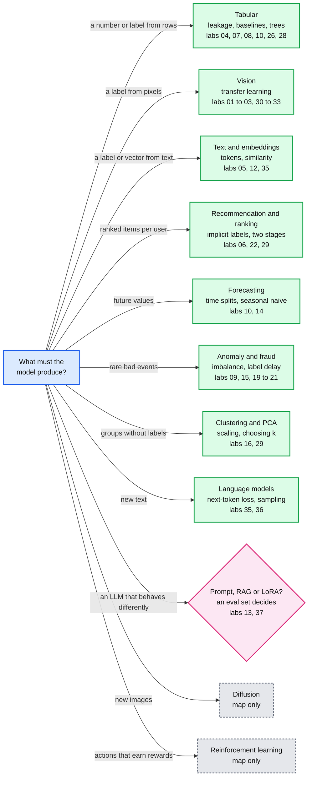
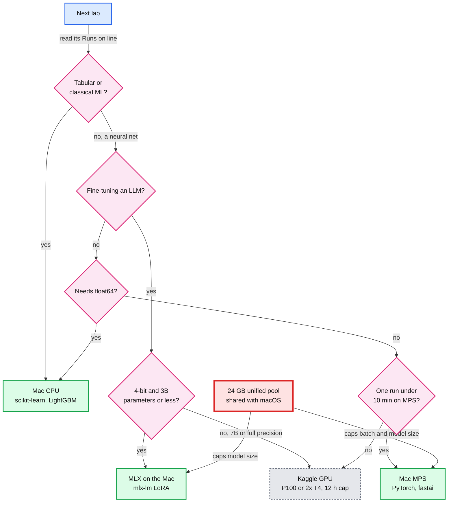
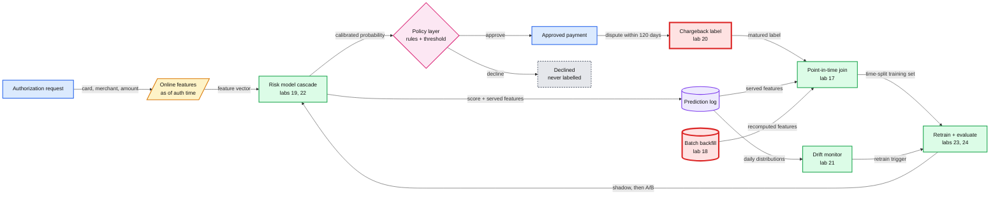

# Learn ML top-down in 37 labs

> The final 40-lab curriculum is [../README.md](../README.md). It replaces section 5's 37-lab table.

> **One-line answer:** learn machine learning (ML) the fast.ai way: ship a working model in the first session, then peel back one layer at a time across 37 one-hour labs in 7 modules. Run 36 of them on the M4 Pro (its CPU, its GPU through PyTorch, or MLX, Apple's array framework) and use Kaggle's free P100 or 2x T4 only when one run passes about 10 minutes. Let the AI write setup and plotting code, but keep the prediction, the split, the metric, the break-it explanation and a 15-line rebuild for yourself.

**Bottom line**

- **This plan maps ML into 11 problem types, and each teaches one idea best.** Fraud teaches imbalance and label delay. Recommendation teaches leakage and two-stage retrieval. Tabular teaches baselines, and trees still beat neural nets on medium-sized tables (45 datasets in [Grinsztajn et al. 2022](https://arxiv.org/abs/2207.08815)). The map is §1.
- **No single course covers this learner.** Use fast.ai Part 1 (8 numbered lessons plus a data-ethics bonus) as the spine for the first module. Borrow leakage and pipelines from Kaggle Learn Intermediate ML (4 hours), backprop and GPT from Karpathy, and production from Rules of ML and Huyen. Skip 5 sources that are stale, archived or too long (§2).
- **The Mac is not the bottleneck. Its 24 GB shared memory pool is the ceiling.** The M4 Pro has 273 GB/s of bandwidth and a 20-core GPU ([Apple](https://www.apple.com/newsroom/2024/10/apple-introduces-m4-pro-and-m4-max/)). Every lab here fits, if you stay at or below 3B-parameter 4-bit models for fine-tuning. Kaggle is the cloud fallback. Lightning AI's pricing page was down behind a security-incident notice on 17 Oct 2026 (§3).
- **Use Python 3.13 in a uv virtual environment outside the repo.** fastai's CI tests 3.11 to 3.13, and torchvision 0.29.1 excludes Python 3.14.1. One note said CatBoost has no Apple-silicon wheel. That was wrong: 1.2.10 ships universal2 wheels up to cp314.
- **The AI risk is measured, not hypothetical.** In Anthropic's trial, 52 engineers learning a new library scored 50% on the quiz with AI vs 67% by hand (Cohen's d = 0.738) ([paper](https://arxiv.org/abs/2601.20245)). Unrestricted GPT-4 lowered closed-book exam scores 17% in a field trial of nearly 1,000 students ([Bastani et al.](https://pmc.ncbi.nlm.nih.gov/articles/PMC12232635/)). Each 60-minute session therefore forces predict, explain and rebuild steps with no AI (§4).
- **The curriculum (§5) is 37 labs in 7 modules, plus a 12-lab minimum path and 3 capstone projects.** The production module (8 labs) maps each lab to a payments-risk interview question and to this repo's [`hld/payments-risk-decisioning/`](../../hld/payments-risk-decisioning/solution.md) set (§6).

---

## 1. Eleven problem types, each with one idea it teaches best



Grey dashed nodes are mapped but get no lab. The pink node is a decision, not a model family.

| Problem type | What it predicts | Concept it teaches best | Example (company-reported, or the paper) | Labs |
|---|---|---|---|---|
| Tabular classification and regression | One column from the others | Leakage, baselines, gradient-boosted decision trees (GBDT) | Airbnb search: a GBDT drove early gains, then "plateaued" ([Haldar et al.](https://arxiv.org/abs/1810.09591)). Uber DeepETA (estimated time of arrival) answers "within a few milliseconds at most" ([Uber, archived](https://web.archive.org/web/2024id_/https://www.uber.com/blog/deepeta-how-uber-predicts-arrival-times/)) | 04, 07, 08, 10, 26, 28 |
| Image classification | A label per image | Transfer learning: reuse pretrained features | Pinterest Shop The Look ([arXiv 2006.10866](https://arxiv.org/abs/2006.10866)) | 01 to 03, 30 to 33 |
| Text classification and embeddings | A label, or a vector where similar meanings sit close | Tokenization, cosine similarity, strong lexical baselines | On BEIR SciFact, BM25 (a lexical ranking function) scored 0.665 nDCG@10 (normalized discounted cumulative gain at rank 10) vs 0.318 for a dense retriever trained elsewhere ([BEIR](https://arxiv.org/abs/2104.08663)) | 05, 12, 35 |
| Recommendation and ranking | Ordered items per user | Implicit feedback, random-split leakage, two-stage retrieval | YouTube picks "hundreds of videos" from millions under "tens of milliseconds" ([Covington et al. 2016](https://static.googleusercontent.com/media/research.google.com/en//pubs/archive/45530.pdf)) | 06, 22, 29 |
| Time-series forecasting | Future values | Time-based splits, seasonal-naive baselines | DoorDash: "20% relative improvement in ETA accuracy" on "over 2 billion orders annually" ([DoorDash](https://careersatdoordash.com/blog/deep-learning-for-smarter-eta-predictions/)) | 10, 14 |
| Anomaly and fraud detection | Rare, adversarial events | Imbalance (492 frauds in 284,807 rows), PR-AUC (area under the precision-recall curve), label delay, drift | Stripe Radar scores 0 to 99; 65+ is elevated risk, 75+ high ([Stripe](https://docs.stripe.com/radar/risk-evaluation)) | 09, 15, 19, 20, 21 |
| Clustering and dimensionality reduction | Groups without labels | Scaling, choosing k, outliers, PCA (principal component analysis) | FAISS trains its coarse quantizer with k-means ([Johnson et al.](https://arxiv.org/abs/1702.08734)) | 16, 29 |
| Generative language models | The next token | Next-token loss, perplexity, sampling | Codex "powers GitHub Copilot" ([arXiv 2107.03374](https://arxiv.org/abs/2107.03374)) | 35, 36 |
| LLM (large language model) adaptation | Changed model behaviour | Prompt vs RAG (retrieval-augmented generation) vs LoRA (low-rank adaptation), decided by evals | LinkedIn's support RAG cut median per-issue resolution time 28.6% over about 6 months ([arXiv 2404.17723](https://arxiv.org/abs/2404.17723)) | 13, 37 |
| Diffusion | New images | Noise schedules | Stable Diffusion builds on latent diffusion ([arXiv 2112.10752](https://arxiv.org/abs/2112.10752)) | none |
| Reinforcement learning (RL) | A policy from rewards | Exploration, off-policy correction | YouTube's REINFORCE recommender ([arXiv 1812.02353](https://arxiv.org/abs/1812.02353)) | none |

Three calls this map forces:

- **Tabular default is LightGBM, not a neural net.** Trees "remain state-of-the-art on medium-sized data (~10K samples)" across 45 datasets ([Grinsztajn et al.](https://arxiv.org/abs/2207.08815)). TabPFN beat a 4-hour tuned ensemble "in 2.8 s" on datasets up to 10,000 samples ([Nature, 2025](https://www.nature.com/articles/s41586-024-08328-6)).
- **TabPFN is a comparison, not a payments default.** Its weights for 2.5, 2.6, 3 and 3.5 are non-commercial. TabPFN-3.5 is the default model, and on CPU, versions 3 and 3.5 cap at 5,000 samples ([TabPFN README](https://github.com/PriorLabs/TabPFN)). A company needs a commercial licence before production use.
- **Diffusion and RL are mapped, not built.** fast.ai's diffusion course is over 30 hours of video ([Part 2](https://course.fast.ai/Lessons/part2.html)). YouTube's RL recommender needed off-policy correction for logged feedback, a hard topic on its own. Neither is a payments-loop topic (my inference). This is the "what I refused to build" line.

---

## 2. Borrow units from nine sources, skip five others

The fast.ai home page says "There are 9 lessons, and each lesson is around 90 minutes long." Its navigation shows Lessons 1 to 8 plus "Bonus: Data ethics", so 9 means 8 numbered lessons plus 1 bonus ([course.fast.ai](https://course.fast.ai/)). The bonus was recorded in 2020 ([lesson 8a](https://course.fast.ai/Lessons/lesson8a.html)).

| Source (state on 17 Oct 2026) | Borrow these units | Labs | Watch out |
|---|---|---|---|
| [fast.ai Practical Deep Learning Part 1](https://course.fast.ai/), 2022 edition: 1 Getting started, 2 Deployment, 3 Neural net foundations, 4 Natural language (NLP), 5 From-scratch model, 6 Random forests, 7 Collaborative filtering, 8 Convolutions | All 8 lessons and their Kaggle notebooks | 01 to 06, 25, 26, 28 to 30 | The site says "We strongly suggest not using your own computer for training models" unless you handle GPU drivers. That warning is about CUDA on Linux. On this Mac, fastai 2.8.12 picks the Apple GPU by itself ([torch_core.py](https://github.com/fastai/fastai/blob/main/fastai/torch_core.py)) |
| [fastbook](https://github.com/fastai/fastbook) (pushed 2026-10-12) | Chapters 1, 2, 4, 5, 7, 8, 9, 10, 13, and 500 numbered questionnaire items across chapters 1 to 19 | Quiz bank, 01 to 06, 25 to 31 | Chapter 2 now needs a SerpAPI key (250 free searches a month), because Microsoft retired the Bing Search APIs on 11 Aug 2025 ([SerpAPI](https://serpapi.com/pricing), [Microsoft](https://learn.microsoft.com/en-us/lifecycle/announcements/bing-search-api-retirement)) |
| [fast.ai Part 2](https://course.fast.ai/Lessons/part2.html) (2022 to 2023), lessons 9 to 25 | [L13](https://course.fast.ai/Lessons/lesson13.html) backprop, [L17](https://course.fast.ai/Lessons/lesson17.html) initialization, [L18](https://course.fast.ai/Lessons/lesson18.html) accelerated SGD (stochastic gradient descent) and ResNets | 27, 31, 32 | Diffusion lessons stay map only |
| [Karpathy, Zero to Hero](https://karpathy.ai/zero-to-hero.html) (2022 to 2024) and [nanoGPT](https://github.com/karpathy/nanoGPT) | micrograd (2:25:52), makemore part 3, "Let's build GPT" (1:56:20), the tokenizer (2:13:34) | 27, 32, 35, 36 | nanoGPT calls itself "very old and deprecated" since Nov 2025, but it is still the smallest readable training loop. Its successor nanochat runs a speedrun on an 8xH100 node ([nanochat](https://github.com/karpathy/nanochat)) |
| [Kaggle Learn](https://www.kaggle.com/learn/intermediate-machine-learning) | Intermediate ML (4 hours: missing values, categorical variables, pipelines, cross-validation, XGBoost, data leakage), Time Series, Feature Engineering, Computer Vision, Intro to ML, Intro to Deep Learning | 04, 07, 08, 10, 14, 16, 30, 33 | Intro to Deep Learning uses Keras. Read it, then port the exercise to PyTorch |
| [Google ML Crash Course](https://developers.google.com/machine-learning/crash-course) (12 modules, exercises of 5 to 40 minutes) | Classification (thresholds, confusion matrix, AUC, the area under the ROC curve), imbalanced datasets, Production ML systems | 09, 19 | No total hours published |
| [Raschka, Build an LLM from Scratch](https://github.com/rasbt/LLMs-from-scratch) (Manning 2024) | Chapter 2 text data and BPE (byte-pair encoding), chapter 3 attention, chapters 4 and 5 GPT and pretraining, appendix E LoRA | 35 to 37 | "designed to run on conventional laptops" |
| Huyen, [Designing ML Systems](https://raw.githubusercontent.com/chiphuyen/dmls-book/main/summary.md) (DMLS, 2022) and [AI Engineering](https://github.com/chiphuyen/aie-book) (AIE, 2025) | DMLS chapters 4 to 9 (training data, features, offline evaluation, deployment, drift and monitoring, test in production). AIE chapters 3 and 4 (evaluation), 6 (RAG), 7 (finetuning) | 13, 17 to 21, 37 | Concepts with little code. The labs supply the code |
| [Rules of ML](https://developers.google.com/machine-learning/guides/rules-of-ml) (updated 2025-08-25) and Ng, [Machine Learning Yearning](https://info.deeplearning.ai/machine-learning-yearning-book) | Rules 15, 29, 30, 31, 33 and 37, and Ng's error-analysis chapters | 10, 11, 17 to 19, 24 | The Ng text in the notes came from a third-party copy of the draft |

Skip these five. Each was checked on 17 Oct 2026.

- **LLM101n.** The repo says "this course does not yet exist" and is archived ([GitHub](https://github.com/karpathy/LLM101n)).
- **d2l.ai.** The last release is v1.0.3 from 2023-08-18 ([d2l-en](https://api.github.com/repos/d2l-ai/d2l-en)). Keep it as a math reference only.
- **Hugging Face Deep RL.** It is in a "low-maintenance state" and Unit 7 is "non-functional" ([deep-rl-class](https://github.com/huggingface/deep-rl-class)).
- **Full Stack Deep Learning.** The deep learning course is the 2022 edition ([FSDL](https://fullstackdeeplearning.com/)).
- **DeepLearning.AI Deep Learning Specialization.** It runs 129 hours over 5 courses in TensorFlow ([Coursera](https://www.coursera.org/specializations/deep-learning)). The theory is good, but the cost is wrong for a 1-hour-lab plan.

---

## 3. The M4 Pro runs 36 of 37 labs, and memory is the ceiling

- **Hardware.** The M4 Pro has "up to 10 performance cores and four efficiency cores", a GPU of "up to 20 cores", and "273GB/s of memory bandwidth" ([Apple](https://www.apple.com/newsroom/2024/10/apple-introduces-m4-pro-and-m4-max/)). This machine has the 14-core CPU, the 20-core GPU, and 24 GiB of unified memory (checked with `sysctl` and `system_profiler`). macOS, your apps and every GPU tensor share that pool.
- **MPS (Metal Performance Shaders, PyTorch's Apple-GPU backend) has one hard gap.** It "does not support `torch.float64`". `PYTORCH_ENABLE_MPS_FALLBACK=1` "does not apply", so double-precision work "has to run on the CPU" ([PyTorch MPS notes](https://github.com/pytorch/pytorch/blob/main/docs/source/notes/mps.md)).
- **The MPS allocator has a hard cap.** `PYTORCH_MPS_HIGH_WATERMARK_RATIO` defaults to 1.7. At 1.0 the cap equals the "recommended maximum allocation size" ([PyTorch env vars](https://github.com/pytorch/pytorch/blob/main/docs/source/mps_environment_variables.md)). Lab 34 finds the real failure point on this Mac.
- **Skip `torch.compile` on the Mac.** Inductor's MPS backend calls itself "an early prototype" ([mps.py](https://github.com/pytorch/pytorch/blob/main/torch/_inductor/codegen/mps.py)). nanoGPT's CPU recipe already passes `--compile=False`.
- **fastai picks MPS automatically.** Set `defaults.use_cuda = False` to force the CPU ([torch_core.py](https://github.com/fastai/fastai/blob/main/fastai/torch_core.py)). Labs 06 and 29 start on the CPU, because issue [#3924](https://github.com/fastai/fastai/issues/3924) ("collab_learner and fit_one_cycle crashes kernel on M2 Macs") is still open, and its reporter says the "Same source runs ok on 'cpu'".
- **MLX (Apple's array framework for Apple silicon) is the fine-tuning path.** mlx-lm's LoRA CLI defaults to `--batch-size 4` and `--num-layers 16`, and it also runs QLoRA (LoRA on a quantized model). Its 32 GB example, full-precision Mistral-7B at batch 1 with 4 layers, "runs at about 250 tokens-per-second" on an M1 Max ([LORA.md](https://github.com/ml-explore/mlx-lm/blob/main/mlx_lm/LORA.md)).
- **Weight sizes set what fits.** Llama-3.2-1B 4-bit is 695.3 MB, 3B 4-bit is 1,807.5 MB, Mistral-7B 4-bit is 4,077.5 MB, and full-precision Mistral-7B is 14,483.5 MB ([Hugging Face API](https://huggingface.co/api/models/mistralai/Mistral-7B-v0.1?blobs=true)). So: LoRA on 1B and 3B 4-bit models fits easily. 7B 4-bit at batch 1 should fit but is untested here. Full-precision 7B goes to the cloud.
- **Speed anchors (M4 Pro is not in any public benchmark).** ResNet-50 on CIFAR-100 takes 117.3 s per epoch at batch 128 on an M3 Pro, vs 11.8 s on an NVIDIA TITAN RTX. DistilBERT on full IMDB (3 epochs, batch 16) took 1,531 s on an M3 Max at 49 samples/s, and batch 512 failed ([mac-ml-speed-test](https://github.com/mrdbourke/mac-ml-speed-test)). nanoGPT's small character model trains in "~3 minutes" on a CPU to a validation loss of 1.88, and MPS is "2-3X" faster ([nanoGPT](https://github.com/karpathy/nanoGPT)).
- **Classical ML has arm64 wheels, but no GPU boosting on the Mac.** scikit-learn 1.9.1, LightGBM 4.7.0 and XGBoost 3.4.1 all ship arm64 wheels ([PyPI](https://pypi.org/pypi/xgboost/json)). "The GPU version is not supported on macOS" for LightGBM ([docs](https://github.com/microsoft/LightGBM/blob/master/docs/Installation-Guide.rst)). XGBoost and LightGBM load Homebrew's `libomp` (`brew install libomp`).



The 10-minute threshold is a starting rule, not a sourced number. A local run starts in seconds. A cloud notebook adds a session start, possibly a queue, and a 20-minute idle timeout. Lab 34 measures the run length where Kaggle actually wins on this Mac.

### Free cloud GPUs on 17 Oct 2026

| Provider | Free offer, as shown | Limits | Verdict |
|---|---|---|---|
| [Kaggle Notebooks](https://www.kaggle.com/docs/notebooks) | "a single NVIDIA Tesla P100", or "2 Nvidia Tesla T4 GPUs", or a TPU v3-8 | "12 hours execution time for CPU and GPU notebook sessions" (9 h for TPU). 20 minutes idle in the editor. "in busy times, you might be placed in a queue" | Default cloud. The base weekly GPU quota is **not on the docs page: unverified**. Read it on your account's quota page. Colab Pro and Pro+ link for 15 and 30 extra hours a week |
| [Google Colab](https://research.google.com/colaboratory/faq.html) | Free tier GPU, type varies | "at most 12 hours". "Colab does not publish these limits" | Backup only |
| [Lightning AI](https://lightning.ai/pricing) | Unknown | The pricing page returned HTTP 503 with an "October 2026 Security Incident" notice. Platform access was revoked "on October 16 at 1:00 AM UTC" | **Unverified.** Neither the "80 free GPU hours" nor the "30 free credits" figure could be confirmed. Do not plan on it. The notice asks every user to rotate credentials stored there |
| [Modal](https://modal.com/pricing) | Starter plan: "$30 / month free credits" | Pay per use beyond that | Fine for a scripted batch job, not notebook-first |
| [Hugging Face ZeroGPU](https://huggingface.co/docs/hub/spaces-zerogpu) | Free account: 5 minutes a day on RTX Pro 6000 Blackwell GPUs | Spaces only. Free accounts with a verified email, older than 30 days, can host 2 ZeroGPU Spaces | Demos (lab 03), not training |
| [SageMaker Studio Lab](https://docs.aws.amazon.com/sagemaker/latest/dg/studio-lab-overview.html) | "no longer open to new customers" | None | Skip |

Go to Kaggle for:

- the full-size variants of labs 02, 05, 31 and 33;
- the cloud half of lab 34;
- anything CUDA-only;
- full-precision 7B fine-tunes;
- running fast.ai's own notebooks as designed.

Skip multi-GPU runs entirely: nanochat's speedrun and the 4-day GPT-2 reproduction on 8xA100 ([nanoGPT](https://github.com/karpathy/nanoGPT)).

### Python 3.13, not 3.14

- **torchvision 0.29.1 declares `requires_python = "!=3.14.1,>=3.10"`.** It ships cp313 and cp314 macOS arm64 wheels ([PyPI](https://pypi.org/pypi/torchvision/json)). The two notes did not really conflict: 3.14.1 is refused and 3.14.3 is allowed. The exclusion still shows that 3.14 patch releases can break this stack.
- **fastai's CI matrix is `["3.11", "3.12", "3.13"]`** ([main.yml](https://github.com/fastai/fastai/blob/main/.github/workflows/main.yml)).
- **Every package checked has a cp313 wheel or a pure-Python wheel.** That covers torch 2.14.1 (127.3 MB wheel), torchvision 0.29.1, mlx 0.32.4, scikit-learn 1.9.1, catboost 1.2.10, xgboost 3.4.1, lightgbm 4.7.0, fastai 2.8.12, tabpfn 9.2.0 and mlx-lm 0.32.2 ([PyPI torch](https://pypi.org/pypi/torch/json)).
- **Version floors all clear 3.13:** xgboost needs 3.12 or newer, and scikit-learn and mlx-lm need 3.11 or newer. 3.13 gets security fixes "until October 2029" ([PEP 719](https://raw.githubusercontent.com/python/peps/main/peps/pep-0719.rst)).
- **The fallback is the installed 3.14.3.** fastai 2.8.12 and torch 2.14.1 resolved with wheels only and trained one epoch on MPS in the research smoke test. Never use 3.14.1. Not 3.15 either: torch 2.14.1 ships no cp315 wheel.
- **CatBoost is fine on both.** catboost 1.2.10 has `macosx_11_0_universal2` wheels for cp38 to cp314 ([PyPI](https://pypi.org/pypi/catboost/json)). The note that said "no macOS arm64 wheel" was wrong.

---

## 4. Let the AI type, keep five things for yourself

### What the evidence says

- **AI access lowered quiz scores in a randomized trial.** Anthropic randomized 52 mostly junior engineers (26 per arm) to learn the Trio async library. The AI group averaged 50% on the quiz vs 67% for hand-coding (Cohen's d = 0.738, p = 0.010). It was about 2 minutes faster, which was not significant. The largest gap was on debugging questions ([blog](https://www.anthropic.com/research/AI-assistance-coding-skills), [paper](https://arxiv.org/abs/2601.20245)).
- **How you use the AI matters more than whether you use it.** Low scorers (quiz under 40%) fell into three patterns: AI delegation (n = 4), progressive AI reliance (n = 4) and iterative AI debugging (n = 4). High scorers (65% or more) used generation-then-comprehension (n = 2), hybrid code-explanation (n = 3) or conceptual inquiry (n = 7). The authors say the pattern analysis is not causal ([paper](https://arxiv.org/abs/2601.20245)).
- **Hints protected learning but did not add to it.** In a field trial of nearly 1,000 students in about 50 classes, GPT Base raised practice scores 48% and lowered the closed-book exam 17% vs control. GPT Tutor, which gave teacher-designed hints, raised practice 127% with no significant exam loss and no exam gain. Students in GPT Base did not perceive that they had learned less ([Bastani et al., PNAS 2025](https://pmc.ncbi.nlm.nih.gov/articles/PMC12232635/)).
- **Your feeling of speed is unreliable.** In METR's trial, 16 experienced open-source developers took 19% longer with AI allowed. They had expected a 24% speed-up and still believed in a 20% speed-up afterward ([METR](https://metr.org/blog/2025-07-10-early-2025-ai-experienced-os-dev-study/)).
- **Classic learning science supplies the session mechanics:**
  - **Retrieval practice beat restudy** after 2 days (68% vs 54%, d = 0.95) and after 1 week (56% vs 42%, d = 0.83). Restudy won only at 5 minutes, 81% vs 75% ([Roediger and Karpicke 2006](https://www.gwern.net/docs/spaced-repetition/2006-roediger.pdf)).
  - **Pretesting** gave 75% vs 56% for extra study (d = 1.1 as reported) ([Richland et al. 2009](https://learninglab.uchicago.edu/Pre-Testing_files/RichlandKornellKao.pdf)).
  - **Self-explanation** gave g = .55 (95% CI .45 to .65) across 69 effect sizes and 5,917 participants ([Bisra et al. 2018](https://www.Gwern.net/doc/psychology/spaced-repetition/2018-bisra.pdf)).
  - **Interleaving** gave g = 0.42 overall and g = 0.34 for maths tasks ([Brunmair and Richter 2019](https://www.psychologie.uni-wuerzburg.de/fileadmin/06020400/2019/Brunmair_Richter_in_press__2019_META-ANALYSIS_OF_INTERLEAVED_LEARNING.pdf)).
  - **Spacing:** the best gap is 20 to 40% of a 1-week test delay, which is 1.4 to 2.8 days ([Cepeda et al. 2008](https://www.evullab.org/pdf/CepedaVulRohrerWixtedPashler-PS-2008.pdf)).
  - **Expertise reversal:** worked examples help novices, then should fade ([Kalyuga 2007](https://www.uky.edu/~gmswan3/EDC608/Kalyuga2007_Article_ExpertiseReversalEffectAndItsI.pdf)). Strong Python skill does not supply ML schemas, so expect worked examples to help at first (my inference, untested for this learner).
- **Gaps.** No randomized trial has tested AI-assisted ML learning. No verified study measures retention past one week.

### Rules: what to delegate, what to keep, how to ask

| Task in a lab | Who does it | How to ask | Why |
|---|---|---|---|
| Environment, downloads, imports | AI | "Write the setup cell. Pin versions." | Not the learning target |
| Plots and boilerplate | AI | "Plot X against Y. Do not touch my model code." | Same |
| Core code for the lab's concept | AI drafts, you explain it, then retype it from memory | "Write it with a line-by-line explanation, then quiz me on two lines." | Generation-then-comprehension and hybrid code-explanation scored 65% or more. Pure delegation scored under 40% |
| The prediction, as a number plus a 0 to 100 confidence | You, before any AI | None | Pretesting: 75% vs 56% |
| Metric and split | You | "Critique my choice. Do not propose one first." | This is the judgement that interviews test. Rules of ML #33 |
| Reading curves and the break-it result | You first, then AI critique | "Here is my reading. Find the claim most likely to be wrong." | Self-explanation g = .55 |
| Debugging | You, with hints | "One hint and one question. No fix." | Iterative AI debugging scored under 40%. Bastani's hints held exam scores flat |
| Rebuild, 15 to 20 lines | You, no AI | None | micrograd's engine is "about 100" lines ([micrograd](https://github.com/karpathy/micrograd)), so a 15-line piece is a real slice. The learning-science note's template gives the rebuild 7 minutes |
| Next session's quiz | AI writes it, you answer closed book | "Three questions, one at a time. Wait for my answer." | Testing effect |

Prompt patterns to paste. These are untested design suggestions from the learning-science note.

```
Give me one hint, then ask me a question about my reasoning. Do not write code.
Before you answer, ask me what I predict the output will be.
Here is my explanation. Find the claim most likely to be wrong and ask me a question that tests it.
Quiz me with three closed-book questions, one at a time. Wait for my answer.
Explain why accuracy misleads on this data. Do not edit my code.
```

Tool settings:

- **Claude Code.** Its built-in Learning output style "leaves small pieces of code for you to write yourself", marks them with `TODO(human)`, then "stops and waits" ([docs](https://code.claude.com/docs/en/output-styles)). Use Learning for core-concept code and Default for setup.
- **Other tutor modes.** ChatGPT study mode and Gemini Guided Learning are similar. None of the vendor pages reports a measured learning benefit.
- **A course policy worth copying.** Stanford CS336 allows LLMs "for low-level programming questions or high-level conceptual questions", prohibits "using it directly to solve the problem", and asks students to disable autocomplete ([CS336](https://cs336.stanford.edu/)).
- **Calibrate yourself.** Keep a prediction log. Your hit rate over 10 labs is a crude score for your own judgement. Bastani's students and METR's developers both misjudged themselves.

### The 60-minute session loop

```mermaid
%% The 60-minute lab loop. Pink = no AI. Green = AI may write code. Red = the block that gets squeezed first when a run overruns.
flowchart LR
    R["0:00 Retrieval<br/>3 closed-book questions"] -->|misses logged| P["0:05 Predict<br/>number + confidence"]
    P -->|written prediction| B["0:12 Run baseline<br/>compare to prediction"]
    B -->|actual vs predicted| C["0:22 Change one thing<br/>predict direction and size"]
    C -->|second result| K["0:32 Break it<br/>leak, corrupt, drop"]
    K -->|failure output| E["0:42 Explain-back + rebuild<br/>no AI, 15 to 20 lines"]
    E -->|weakest claim fixed| Q["0:57 Close<br/>3 flashcards, next slot booked"]
    Q -->|1 to 3 days later| N["Next session<br/>opens with these flashcards"]
    AI[AI assistant] -.->|code on request| B
    AI -.->|code on request| C
    AI -.->|hints only| K
    AI -.->|critique only, after you write| E

    class R,P,N decision
    class B,C,K service
    class E critical
    class Q store
    class AI external

    classDef client   fill:#dbeafe,stroke:#2563eb,stroke-width:2px,color:#111
    classDef service  fill:#dcfce7,stroke:#16a34a,stroke-width:2px,color:#111
    classDef store    fill:#ede9fe,stroke:#7c3aed,stroke-width:2px,color:#111
    classDef cache    fill:#fef3c7,stroke:#d97706,stroke-width:2px,color:#111
    classDef queue    fill:#cffafe,stroke:#0891b2,stroke-width:2px,color:#111
    classDef critical fill:#fee2e2,stroke:#dc2626,stroke-width:4px,color:#111
    classDef external fill:#e5e7eb,stroke:#6b7280,stroke-width:2px,color:#111,stroke-dasharray:4 3
    classDef decision fill:#fce7f3,stroke:#db2777,stroke-width:2px,color:#111
```



- **The red block breaks first.** Explain-back and rebuild come last, so a slow download or a long run eats them. Fix: download data before the session, keep compute to 20 minutes or less, and hard-stop the run at 0:32.
- **The AI sits outside the trust boundary (grey).** It may write code for the baseline and the change step. It gives hints, not fixes, during break-it. It critiques only after you have written your explanation.
- **One hour is a sound unit.** The Anthropic study's tasks and surveys took at most 1 hour 15 minutes and averaged 58.5 minutes ([paper](https://arxiv.org/abs/2601.20245)). No verified study gives a better length, so book a second contact 1 to 3 days later instead of running longer.
- **Watch or skim the borrowed unit before the session.** Fast.ai lessons run about 90 minutes, and the site suggests skimming student notes first ([course.fast.ai](https://course.fast.ai/)).

---

## 5. The curriculum: 37 labs in 7 modules, working models first

```mermaid
%% Module order, top-down in the fast.ai way. Red = where silent failures live: leakage and label delay raise the score instead of raising an error.
flowchart LR
    M1["M1 Whole game<br/>labs 01 to 06"] -->|five working models| M2["M2 Do not fool yourself<br/>labs 07 to 11"]
    M2 -->|validation habits| M3["M3 More of the map<br/>labs 12 to 16"]
    M3 -->|every problem type seen| M4["M4 Production ML, payments<br/>labs 17 to 24"]
    M4 -->|now ask why it works| M5["M5 Under the hood<br/>labs 25 to 29"]
    M5 -->|gradients, trees, embeddings| M6["M6 Deep nets on a Mac<br/>labs 30 to 34"]
    M6 -->|training dynamics| M7["M7 Language models<br/>labs 35 to 37"]
    M7 -->|all modules done| CAP["Capstones<br/>3 projects, 4 sessions each"]
    MIN["Minimum path<br/>12 labs"] -.->|labs 01, 04| M1
    MIN -.->|labs 08, 09, 11| M2
    MIN -.->|labs 17 to 20, 22, 23| M4
    MIN -.->|lab 25| M5

    class M1,M3,M5,M6,M7 service
    class M2,M4 critical
    class CAP client
    class MIN decision

    classDef client   fill:#dbeafe,stroke:#2563eb,stroke-width:2px,color:#111
    classDef service  fill:#dcfce7,stroke:#16a34a,stroke-width:2px,color:#111
    classDef store    fill:#ede9fe,stroke:#7c3aed,stroke-width:2px,color:#111
    classDef cache    fill:#fef3c7,stroke:#d97706,stroke-width:2px,color:#111
    classDef queue    fill:#cffafe,stroke:#0891b2,stroke-width:2px,color:#111
    classDef critical fill:#fee2e2,stroke:#dc2626,stroke-width:4px,color:#111
    classDef external fill:#e5e7eb,stroke:#6b7280,stroke-width:2px,color:#111,stroke-dasharray:4 3
    classDef decision fill:#fce7f3,stroke:#db2777,stroke-width:2px,color:#111
```



How to read the tables:

- **Order.** Modules 1 to 4 are practical (24 labs). Modules 5 to 7 open the internals (13 labs). This follows fast.ai's "start with complete useful solutions to real world problems, and gradually work down to the basic foundations" ([lesson 1](https://course.fast.ai/Lessons/lesson1.html)).
- **Runs on, time.** This is compute inside the 60 minutes. It is my estimate unless the row cites a benchmark. Record the real number in the lab.
- **Predict first** is written down before any code runs. **Break it** is the failure step. **Record** is the number that goes in the lab file and the prediction log.
- **Pace.** Three labs a week finishes the 37 in about 13 weeks. Do one M4 lab a week from week 3 onward if an interview is close (interleaving, g = 0.42).

### M1. Whole game: five working models before any theory

| # | Lab: concept | Dataset (size, source) | Runs on, time | Predict first | Break it | Record | Borrowed from |
|---|---|---|---|---|---|---|---|
| 01 | **Is it a bird?** Transfer learning turns 200 images into a classifier | About 200 images you collect with [`ddgs`](https://pypi.org/pypi/ddgs/json) (the renamed `duckduckgo_search`), 2 classes. Fallback: cats vs dogs from Oxford-IIIT Pet | Mac MPS, ~5 min | Error rate after 3 fine-tuning epochs? | Train the same net from random weights for the same epochs | Error rate, pretrained vs from scratch; seconds per epoch | fast.ai L1 ["Is it a bird?"](https://www.kaggle.com/code/jhoward/is-it-a-bird-creating-a-model-from-your-own-data) notebook; fastbook ch 1 |
| 02 | **Pet breeds.** Frozen backbone vs full fine-tune | [Oxford-IIIT Pet](https://www.robots.ox.ac.uk/~vgg/data/pets/), 37 breeds, about 200 images each, 811.7 MB, CC BY-SA 4.0 | Mac MPS, ~15 min. Kaggle for 5+ epochs | Will you beat the 2012 paper's 59.21% accuracy? By how much? | Unfreeze at 10x the learning rate | Accuracy frozen, unfrozen, and vs 59.21%; minutes per epoch | fast.ai [L2](https://course.fast.ai/Lessons/lesson2.html); fastbook ch 5 |
| 03 | **Ship it.** Inference is a service: size, p95 latency, out-of-distribution inputs | Lab 02's model; 200 held-out images plus 20 non-pet photos | Mac CPU, ~5 min | p95 latency per image on the CPU? | Feed in the 20 non-pet photos | Export size in MB; p50 and p95 over 200 calls; share of non-pets scored above 0.9 | fast.ai L2 (Gradio, Hugging Face Spaces); fastbook ch 2 |
| 04 | **Tabular in ten minutes.** GBDT as the default; majority baseline; AUC | [Adult](https://archive.ics.uci.edu/dataset/2/adult), 48,842 rows, 14 features, 23.9% positive, CC BY 4.0 | Mac CPU, ~2 min | Accuracy of always predicting `<=50K`? LightGBM AUC? | Shuffle the target column. An AUC above 0.55 means a leak or a bug | Accuracy and AUC for majority, logistic regression, LightGBM, and TabPFN on 5,000 rows | fast.ai [L6](https://course.fast.ai/Lessons/lesson6.html); Kaggle [Intro to ML](https://www.kaggle.com/learn/intro-to-machine-learning); [TabPFN README](https://github.com/PriorLabs/TabPFN) |
| 05 | **Text.** Bag of words vs a pretrained transformer | [IMDB](https://huggingface.co/datasets/stanfordnlp/imdb), 25,000 train and 25,000 test reviews, 83.46 MB. Train on 2,000 | Mac MPS, ~10 min. Kaggle for the full set | Accuracy gap between TF-IDF (term frequency, inverse document frequency) plus logistic regression and DistilBERT, on the same 2,000 reviews? | Truncate reviews to 32 tokens | Accuracy both ways; training seconds; accuracy at 32 vs 256 tokens | fast.ai [L4](https://course.fast.ai/Lessons/lesson4.html); fastbook ch 10 |
| 06 | **Recommender.** Embeddings learned from ratings | [MovieLens 100K](https://grouplens.org/datasets/movielens/), 100,000 ratings, 943 users, 1,682 movies, 4.92 MB, research use only | Mac CPU, ~2 min | RMSE (root mean squared error) of "predict the global mean" vs the model? | Weight decay 0 for 20 epochs | RMSE for mean, dot product, and dot product plus bias; train vs validation curve | fast.ai [L7](https://course.fast.ai/Lessons/lesson7.html); fastbook ch 8 |

- **TabPFN (lab 04)** opens a browser login to accept its licence on first use. On CPU it caps at 5,000 samples for versions 3 and 3.5 ([README](https://github.com/PriorLabs/TabPFN)).

### M2. Do not fool yourself: leakage, splits, metrics, error analysis

| # | Lab: concept | Dataset (size, source) | Runs on, time | Predict first | Break it | Record | Borrowed from |
|---|---|---|---|---|---|---|---|
| 07 | **Leak through preprocessing.** Fit every transform inside each CV (cross-validation) fold | [House Prices](https://www.openml.org/d/42165), 1,460 rows, 81 columns (Kaggle `house-prices-advanced-regression-techniques`) | Mac CPU, ~2 min | Does target-encoding `Neighborhood` on all rows lower 5-fold CV MAE (mean absolute error)? By how many dollars? | Encode before the split | CV MAE, leaky vs Pipeline; the gap in $ | Kaggle [Intermediate ML](https://www.kaggle.com/learn/intermediate-machine-learning): Pipelines, Cross-Validation, Data Leakage |
| 08 | **Leak through a post-outcome column.** Ask "when is this value known?" | [Titanic](https://www.openml.org/d/40945), 1,309 rows, 14 features; `boat` is set for survivors | Mac CPU, ~1 min | CV accuracy with `boat` included? | Include `boat` and `body` | CV accuracy with vs without; top-3 feature importances each time | Kaggle Intermediate ML: Data Leakage; fast.ai [L5](https://course.fast.ai/Lessons/lesson5.html) Titanic notebooks |
| 09 | **Accuracy lies on rare events.** Precision, recall, PR-AUC (area under the precision-recall curve), a cost threshold | [Credit Card Fraud](https://www.openml.org/d/1597), 284,807 transactions, 492 frauds (0.1727%); V1 to V28 are PCA components | Mac CPU, ~2 min | Accuracy of "never fraud"? PR-AUC of logistic regression? | Pick the threshold on the test set, then score a fresh split | Accuracy, ROC-AUC, PR-AUC; precision and recall at 3 thresholds; the cheapest threshold when a missed fraud costs 5x a false decline | Google MLCC [Classification](https://developers.google.com/machine-learning/crash-course) |
| 10 | **Random vs time split.** Test on the future, not a shuffle | [Bike Sharing](https://archive.ics.uci.edu/dataset/275/bike+sharing+dataset) hourly file, 17,389 instances per UCI, 13 features, CC BY 4.0 | Mac CPU, ~1 min | RMSE gap between a random split and a last-30-days split? | Keep `casual` and `registered`, which sum to the target `cnt` | RMSE on both splits, with and without the two leaky columns | [Rules of ML](https://developers.google.com/machine-learning/guides/rules-of-ml) #33; Kaggle [Time Series](https://www.kaggle.com/learn/time-series) lesson 1 |
| 11 | **Error analysis by hand.** Errors decide the next experiment | The 50 highest-loss validation items from lab 02 or 05 | Mac, ~2 min compute and 40 min reading | Largest error category and its share? | Flip 10% of the training labels, retrain, tally again | Category counts and shares; the first fix, and why | Ng [Machine Learning Yearning](https://info.deeplearning.ai/machine-learning-yearning-book), error analysis; fast.ai L2 `plot_top_losses` |

- **Lab 11's time budget comes from Ng:** "Manually examining 100 examples does not take long. Even if you take one minute per image, you'd be done in under two hours." Fifty examples fit one session.

### M3. More of the map: retrieval, evals, forecasts, anomalies, clusters

| # | Lab: concept | Dataset (size, source) | Runs on, time | Predict first | Break it | Record | Borrowed from |
|---|---|---|---|---|---|---|---|
| 12 | **Lexical vs dense retrieval.** Embeddings, cosine similarity, a strong baseline | [BEIR SciFact](https://huggingface.co/datasets/BeIR/scifact), 5,183 documents, 300 test queries, 4.55 MB | Mac MPS, ~5 min | Will a small embedding model beat BM25's 0.665 nDCG@10? | Embed the queries with a different model than the documents | nDCG@10 for BM25, dense, and hybrid with RRF (reciprocal rank fusion); documents embedded per second | [BEIR](https://arxiv.org/abs/2104.08663); this repo's [rag-react](../../tool-practise/rag-react/README.md) exercises 04 and 05 |
| 13 | **An eval set and an LLM judge.** Judges need human checks | 50 answers from one task that you label yourself: rag-react answers, or [Bitext](https://huggingface.co/datasets/bitext/Bitext-customer-support-llm-chatbot-training-dataset) support replies (27K rows, 19.20 MB, synthetic by its own README) | Mac with Ollama `qwen2.5:7b`, ~10 min | Judge-vs-you agreement in %? | Swap the order of the two answers in a pairwise prompt | Agreement for 2 judge prompts; flip rate under the swap; tokens per judged item | Huyen [AI Engineering](https://github.com/chiphuyen/aie-book) ch 3 and 4; LLM evaluators "inherit all the problems of the LLMs they evaluate" ([Shankar et al. 2024](https://arxiv.org/abs/2404.12272)) |
| 14 | **Forecast demand.** Seasonal naive first, then lag features | [NYC TLC](https://www.nyc.gov/site/tlc/about/tlc-trip-record-data.page) yellow taxi 2024-01, 49.96 MB parquet, aggregated to zone-hour pickups | Mac CPU, ~3 min | Will LightGBM with lags beat "same hour last week" on MAE? By what %? | Build a lag with `shift(-1)`, which reads the future | MAE for seasonal naive, LightGBM, and the leaky lag | Kaggle Time Series: Trend, Seasonality, Time series as features |
| 15 | **Anomaly windows.** Unsupervised detection, scored by windows | [NAB](https://github.com/numenta/NAB), one of its 58 labelled series | Mac CPU, ~1 min | Which raises more false alarms per day, a z-score or an Isolation Forest? | Set the z-score threshold from the whole series, anomaly included | Hits inside labelled windows and false alarms per day, for both detectors | NAB README; [scikit-learn outlier detection](https://scikit-learn.org/stable/modules/outlier_detection.html) |
| 16 | **Clustering hygiene.** Scaling and outliers decide k-means | [Online Retail](https://archive.ics.uci.edu/dataset/352/online+retail), 541,909 rows | Mac CPU, ~2 min | Share of customers in the biggest cluster, before and after cleaning? | Skip scaling | Cluster sizes and silhouette for raw, cleaned, and cleaned plus scaled | Kaggle [Feature Engineering](https://www.kaggle.com/learn/feature-engineering): Clustering with k-means |

- **Lab 12's rebuild step** is BM25 itself, in about 20 lines, so the lab needs no extra package for it.

### M4. Production ML for payments risk (Staff module, detail in §6)

| # | Lab: concept | Dataset (size, source) | Runs on, time | Predict first | Break it | Record | Borrowed from |
|---|---|---|---|---|---|---|---|
| 17 | **Time split and as-of features.** Point-in-time correct joins | [MovieLens 1M](https://grouplens.org/datasets/movielens/), 1,000,209 ratings, 6,040 users, 5.92 MB | Mac CPU, ~3 min | How much does a "final mean rating" feature inflate AUC for "rating 4 or 5", compared with an as-of mean? | The latest-value join | 2x2 AUC table: random vs time split, as-of vs latest feature | Rules #31, #33; [Feast point-in-time joins](https://docs.feast.dev/getting-started/concepts/point-in-time-joins); Huyen DMLS ch 5 |
| 18 | **Training-serving skew replay.** Two code paths, one feature | NYC TLC yellow 2024-01, 49.96 MB | Mac CPU, ~3 min | Share of rows where "pickups in this zone in the last hour" differs between the batch and serving code? | Serving uses local time and a left-closed window. Batch uses UTC and a right-closed window | Mismatch rate; MAE when trained on batch features and served on serving features | Rules #29, #37; Huyen DMLS ch 7 |
| 19 | **Calibration, downsampling, a precision guardrail** | Credit Card Fraud (284,807 rows, 492 frauds) | Mac CPU, ~3 min | Keep 10% of legitimate rows. What mean fraud probability does the model output on the untouched test set, where the truth is 0.17%? | Downsample without re-weighting. Then fix it with weights or isotonic calibration | Reliability curve and Brier score, before and after; recall at 95% precision | [Guo et al. 2017](https://arxiv.org/abs/1706.04599); [scikit-learn calibration](https://scikit-learn.org/stable/modules/calibration.html); Rules #30; Google MLCC [imbalanced datasets](https://developers.google.com/machine-learning/crash-course/overfitting/imbalanced-datasets) |
| 20 | **Delayed labels.** Immature negatives poison training and evaluation | Credit Card Fraud, spread over 180 simulated days; each fraud gets a 7 to 120 day dispute delay | Mac CPU, ~3 min | How far does recall on the newest cohort fall if unmatured frauds train as legitimate? | Train on "labels as of today" | Observed fraud rate by cohort age; recall with mature-only vs naive labels | [Stripe disputes](https://docs.stripe.com/disputes/how-disputes-work.md); Huyen DMLS ch 4 |
| 21 | **Drift.** Two-sample tests and a domain classifier | NYC TLC yellow 2024-01 (49.96 MB) vs 2024-07 (52.30 MB) | Mac CPU, ~3 min | Domain-classifier AUC for January vs July? For two random halves of January? | Run KS (Kolmogorov-Smirnov) tests on all rows of week 1 vs week 2 of January | Features flagged; classifier AUC; false-alarm rate on the random halves | [Rabanser et al. 2018](https://arxiv.org/abs/1810.11953); Huyen DMLS ch 8 |
| 22 | **Two-stage retrieval, then ranking.** The recall ceiling and p99 | MovieLens 1M (5.92 MB); [MovieLens 32M](https://grouplens.org/datasets/movielens/) (238.95 MB) as a stretch | Mac CPU with faiss-cpu, ~10 min | Recall@100 of the candidate stage? nDCG@10 lift from re-ranking? | Cut candidates from 100 to 10; set the HNSW (hierarchical navigable small world graph) search width to 1 | Recall@100; nDCG@10 before and after ranking; p50 and p99 per request; exact vs ANN (approximate nearest neighbour) recall@10 | [Covington et al. 2016](https://static.googleusercontent.com/media/research.google.com/en//pubs/archive/45530.pdf); [FAISS](https://arxiv.org/abs/1702.08734); [HNSW](https://arxiv.org/abs/1603.09320) |
| 23 | **A/B power and peeking** | Synthetic, no download | Mac CPU, ~2 min | Users per arm to detect a 5% relative lift on a 2% base rate, at 80% power and alpha 0.05? | Peek daily and stop at the first p below 0.05 | Sample size per arm; A/A false-positive rate, fixed horizon vs peeking | [statsmodels NormalIndPower](https://www.statsmodels.org/stable/generated/statsmodels.stats.power.NormalIndPower.html); [SRE Workbook ch 16](https://sre.google/workbook/canarying-releases/) |
| 24 | **Shadow challenger under a latency budget** | Lab 19's models; replay 50,000 test transactions | Mac CPU, ~5 min | p99 latency added by a synchronous shadow call? | Call the shadow inline, then move it to a background queue | p50 and p99 for champion alone, sync shadow, async shadow; share of decisions that differ at the threshold | [SageMaker shadow tests](https://docs.aws.amazon.com/sagemaker/latest/dg/shadow-tests.html); Rules #15 |

### M5. Under the hood: models from scratch

| # | Lab: concept | Dataset (size, source) | Runs on, time | Predict first | Break it | Record | Borrowed from |
|---|---|---|---|---|---|---|---|
| 25 | **Pixel baseline, then SGD by hand.** Loss, gradient, learning rate | MNIST_SAMPLE (3s and 7s), 3.21 MB, from the fastai dataset registry | Mac CPU, ~1 min | Accuracy of "closer to the mean 3 or the mean 7"? | Learning rate 100x | Baseline accuracy; accuracy after 1, 5 and 20 epochs; loss curve | fast.ai [L3](https://course.fast.ai/Lessons/lesson3.html); fastbook ch 4 |
| 26 | **Titanic from scratch.** Matrix multiply, sigmoid, the training loop | Titanic (OpenML 40945, 1,309 rows) or Kaggle `titanic` train.csv | Mac CPU, ~1 min | Does one hidden layer beat the linear model on validation? | Skip log-scaling `Fare` | Validation accuracy, linear vs net; train-validation gap; epochs to converge with and without scaling | fast.ai [L5](https://course.fast.ai/Lessons/lesson5.html), "Linear model and neural net from scratch" |
| 27 | **micrograd.** Chain rule and a gradient check | Synthetic: 20 random expressions | Mac CPU, seconds | Which bug does a finite-difference check catch first? | Assign `grad` with `=` instead of `+=` for a node used twice | Largest absolute gap between analytic and numeric gradients, before and after the bug | Karpathy [micrograd video](https://www.youtube.com/watch?v=VMj-3S1tku0) (2:25:52, watch over 2 evenings); fast.ai Part 2 L13 |
| 28 | **Random forest by hand.** Splits, Gini, bagging, out-of-bag error | Adult (fastai ADULT_SAMPLE, 0.97 MB) | Mac CPU, ~2 min | Validation accuracy at 1, 10 and 100 trees? | One tree with unlimited depth | Accuracy vs tree count; out-of-bag vs validation error | fast.ai [L6](https://course.fast.ai/Lessons/lesson6.html), "How random forests really work"; fastbook ch 9 |
| 29 | **Embeddings from scratch.** DotProductBias, and what factors encode | MovieLens 100K (4.92 MB) | Mac CPU, ~3 min | Will your model land within 0.02 RMSE of lab 06? | Weight decay 0 for 20 epochs | RMSE vs lab 06; the 5 movies at each end of the first PCA axis | fast.ai L7; fastbook ch 8 |

### M6. Deep nets on a Mac: training dynamics and hardware

| # | Lab: concept | Dataset (size, source) | Runs on, time | Predict first | Break it | Record | Borrowed from |
|---|---|---|---|---|---|---|---|
| 30 | **Convolutions by hand, then a CNN (convolutional neural network)** | [MNIST](https://huggingface.co/datasets/ylecun/mnist), 60,000 train and 10,000 test, 18.17 MB parquet | Mac MPS, ~5 min | CNN vs MLP (multi-layer perceptron) accuracy after 1 epoch, at a similar parameter count? | Remove the ReLU between conv layers | A hand-computed 3x3 edge output that equals `F.conv2d`; accuracy for CNN, MLP, and no-ReLU | fast.ai [L8](https://course.fast.ai/Lessons/lesson8.html); fastbook ch 13; Kaggle [Computer Vision](https://www.kaggle.com/learn/computer-vision) |
| 31 | **Learning-rate finder and one-cycle** | [Imagenette](https://github.com/fastai/imagenette) 160 px, 10 classes, 99.0 MB; its leaderboard shows 87.43% at 128 px in 5 epochs | Mac MPS, ~15 min. Kaggle for 320 px (341.7 MB) | Accuracy after 5 epochs at the suggested rate vs 10x that rate? | 10x the suggested rate | The `lr_find` curve; accuracy at 3 rates; seconds per epoch | fastbook ch 5 and 7; fast.ai Part 2 [L18](https://course.fast.ai/Lessons/lesson18.html) |
| 32 | **Initialization and activation statistics** | [Fashion-MNIST](https://github.com/zalandoresearch/fashion-mnist), 60,000 train and 10,000 test, 36.12 MB, MIT | Mac MPS, ~5 min | Activation standard deviation after 10 layers with N(0, 1) weights? | Scale the weights by 10, then by 0.1 | Per-layer standard deviation for naive, Kaiming and BatchNorm; final accuracy each | fast.ai Part 2 [L17](https://course.fast.ai/Lessons/lesson17.html); Karpathy [makemore part 3](https://www.youtube.com/watch?v=P6sfmUTpUmc) |
| 33 | **Overfit on purpose, then regularise** | [CIFAR-10](https://www.cs.toronto.edu/~kriz/cifar.html), 50,000 train and 10,000 test at 32x32, 170.50 MB. Use 5,000 images | Mac MPS, ~15 min | Train-validation gap on 5,000 images with no augmentation? | Train on 500 images to 100% train accuracy | The gap with nothing, augmentation, dropout, and both | Kaggle [Intro to Deep Learning](https://www.kaggle.com/learn/intro-to-deep-learning): overfitting, dropout and batch normalization |
| 34 | **Mac performance: CPU vs MPS vs Kaggle** | [CIFAR-100](https://www.cs.toronto.edu/~kriz/cifar.html), 169.0 MB, ResNet-50 at 32x32 to match the published runs; synthetic tensors for memory | Mac MPS and Kaggle GPU, ~20 min | MPS speed-up over CPU at batch 128? Where does throughput flatten? | Time without `torch.mps.synchronize()`; allocate 512 MB tensors until failure; move a float64 tensor to MPS | Images/s at batch 16 to 512; first-step vs steady-step ms; failure point vs `torch.mps.recommended_max_memory()`; your epoch vs the M3 Pro's 117.3 s; Kaggle epoch time; the run length where Kaggle wins | [mac-ml-speed-test](https://github.com/mrdbourke/mac-ml-speed-test); [PyTorch MPS notes](https://github.com/pytorch/pytorch/blob/main/docs/source/notes/mps.md) |

### M7. Language models from scratch

Karpathy: "In my opinion language models are an excellent place to learn deep learning" ([Zero to Hero](https://karpathy.ai/zero-to-hero.html)).

| # | Lab: concept | Dataset (size, source) | Runs on, time | Predict first | Break it | Record | Borrowed from |
|---|---|---|---|---|---|---|---|
| 35 | **BPE (byte-pair encoding) tokenizer.** The merge loop; bytes vs characters | [TinyShakespeare](https://raw.githubusercontent.com/karpathy/char-rnn/master/data/tinyshakespeare/input.txt), 1,115,394 bytes | Mac CPU, ~2 min | Tokens per 1,000 characters after 256 merges? | Run a character-level, not byte-level, vocabulary on text with an emoji | Tokens per 1,000 characters at 0, 256 and 512 merges; round-trip passes on 10 strings | Karpathy [tokenizer video](https://www.youtube.com/watch?v=zduSFxRajkE) (2:13:34); Raschka ch 2 |
| 36 | **A GPT from scratch.** Attention, the causal mask, sampling | TinyShakespeare | Mac MPS, ~10 min, with `--device=mps --compile=False` | In 10 minutes on MPS, will you land closer to the README's CPU result (1.88) or its A100 result (1.4697)? | Delete the causal mask, retrain, then sample | Validation loss per config; tokens/s on CPU vs MPS; samples at temperature 0.5, 1.0 and 1.5 | Karpathy ["Let's build GPT"](https://www.youtube.com/watch?v=kCc8FmEb1nY) (1:56:20); [nanoGPT](https://github.com/karpathy/nanoGPT); Raschka ch 3 to 5 |
| 37 | **LoRA on a 4-bit model vs 5-shot prompting.** When to fine-tune at all | mlx-lm's WikiSQL example data, or 200 Q&A pairs of your own; [Llama-3.2-1B-Instruct-4bit](https://huggingface.co/mlx-community/Llama-3.2-1B-Instruct-4bit) (695.3 MB), then [3B 4-bit](https://huggingface.co/mlx-community/Llama-3.2-3B-Instruct-4bit) (1,807.5 MB) | MLX, ~20 min | Tokens/s on the M4 Pro vs the doc's ~250 on an M1 Max? | The 3B model with `--num-layers 16 --batch-size 8`; or 5x the iterations | Tokens/s; peak memory; validation loss; exact match on 50 held-out items vs a 5-shot prompt | [mlx-lm LORA.md](https://github.com/ml-explore/mlx-lm/blob/main/mlx_lm/LORA.md); Raschka appendix E; Huyen AIE ch 7 |

### Concepts come back on purpose

Spacing beats massing, so each core idea returns 2 to 7 times across modules. The table is the review schedule.

| Concept | First lab | Comes back in |
|---|---|---|
| Leakage | 04 (shuffle test) | 07, 08, 10, 14, 17, 18, 36 |
| Baselines first | 04 | 06, 09, 12, 14, 25 |
| Thresholds and calibration | 09 | 19, 24 |
| Embeddings | 06 | 12, 22, 29, 35 |
| Time-based splits | 10 | 14, 17, 20, 21 |
| Latency budgets | 03 | 22, 24, 34 |
| Overfitting | 06 | 28, 31, 33, 37 |

### Minimum path: 12 labs

For someone short on time, or an ML design round within a month. In order:

1. **01 Is it a bird?** The whole game in one session.
2. **04 Tabular in ten minutes.** LightGBM is the payments workhorse.
3. **25 Pixel baseline, then SGD by hand.** The one internals lab: what a gradient step is.
4. **08 Post-outcome leak.** The most common real leak.
5. **09 Accuracy lies on rare events.** PR-AUC and cost thresholds.
6. **11 Error analysis by hand.** The habit that picks the next experiment.
7. **17 Time split and as-of features.**
8. **18 Training-serving skew replay.**
9. **19 Calibration and downsampling.**
10. **20 Delayed labels.**
11. **22 Two-stage retrieval and ranking.**
12. **23 A/B power and peeking.**

With 2 more hours, add **21 Drift** and **24 Shadow challenger**.

### Capstone projects: 3 projects, 4 sessions each

Each session uses the same lab template. Each project ends with a fast.ai-style public write-up; the course home page links a "Share your work here" thread ([course.fast.ai](https://course.fast.ai/)).

| Project | Data | Sessions | Deliverable |
|---|---|---|---|
| A. Card-fraud model, end to end | Credit Card Fraud (284,807 rows). Stretch: Kaggle IEEE-CIS (size per its competition page, unverified here) | 1 framing, baseline and time split. 2 as-of features and calibration. 3 delayed labels and the threshold policy. 4 shadow plan and write-up | A 1-page design doc, plus 5 soundbites cross-checked against [`hld/payments-risk-decisioning/`](../../hld/payments-risk-decisioning/solution.md) |
| B. Ride-hailing demand and ETA | NYC TLC 2024 monthly files (about 50 MB each) | 1 zone-hour demand baseline. 2 trip-duration model. 3 drift, January vs July. 4 latency budget and serving | ETA p99 vs Uber DeepETA's "few milliseconds" budget, linked to [`hld/uber-ride-hailing/`](../../hld/uber-ride-hailing/) |
| C. Support triage with retrieval and a small LLM | Bitext (27K rows, synthetic) | 1 TF-IDF classifier. 2 retrieval of similar tickets. 3 LLM-judge eval set. 4 LoRA vs prompting | An eval table: accuracy, judge agreement, tokens per 1,000 tickets |

---

## 6. The production module rehearses 8 payments-risk interview questions

Hello Interview says ML system design interviews become more common by mid-level, and "at the senior level they are the norm". It also says "Model design is the heart" of the round, and interviewers check whether you "can frame a vague business goal as a measurable ML problem" ([Hello Interview](https://www.hellointerview.com/learn/ml-system-design)). In payments risk, the hard parts are about time: labels arrive late, features must be as of the decision, and tests cannot wait for chargebacks.



- **Red: the chargeback label.** Card networks "typically allow cardholders to initiate disputes within 120 days of the original payment". Contested disputes add "usually 7-21 days" to respond and "usually 60-75 days" for the issuer's decision ([Stripe disputes](https://docs.stripe.com/disputes/how-disputes-work.md)). Last month's "legitimate" rows are not yet labels (lab 20).
- **The early proxy is noisy.** "about 40% of Visa and Mastercard EFWs become fraud disputes" when the charge is not refunded (same page). EFWs (early fraud warnings) are a monitoring signal, not ground truth.
- **Red: the batch backfill.** Rules of ML #29 says to save the features used at serving time and train on that log. #37 says to "Measure Training/Serving Skew" ([Rules of ML](https://developers.google.com/machine-learning/guides/rules-of-ml)). Lab 18 measures skew instead of assuming it is zero.
- **Grey: declines are never labelled.** That is a feedback loop: the model chooses which rows can ever become fraud labels. Chaney et al. show such loops can homogenize behaviour "without increasing utility" ([arXiv 1710.11214](https://arxiv.org/abs/1710.11214)).
- **A calibrated score makes thresholds meaningful.** Stripe's default cutoffs are 65 for elevated and 75 for high risk on a 0 to 99 scale ([Radar](https://docs.stripe.com/radar/risk-evaluation)). Lab 19 shows how downsampling breaks that scale.
- **The vendor numbers to know (all Stripe-reported):**
  - Radar 2.0 "helped reduce fraud by over 25%" without raising the false-positive rate ([2018](https://stripe.com/en-in/blog/radar-2018)).
  - The 2025 payments foundation model is "trained on tens of billions of transactions" and lifted card-testing detection on large users "from 59% to 97%" ([2025](https://stripe.com/blog/using-ai-optimize-payments-performance-payments-intelligence-suite)).
- **Scale for the learner's Uber context.** Michelangelo ran "more than 5K models in production, serving 10 million real-time predictions per second at peak" in 2024 ([Uber](https://www.uber.com/en-GB/blog/from-predictive-to-generative-ai)).

| Lab | Interview question it answers | Ride-hailing risk analogue (illustration) | Repo deep dive |
|---|---|---|---|
| 17 | "How do you build velocity features without leaking the future?" | Trips per rider in the last hour, as of request time | [features-and-freshness](../../hld/payments-risk-decisioning/deep-dives/features-and-freshness.md) |
| 18 | "Offline AUC is high and production is lower. Where do you look first?" | Streaming vs batch GPS features | [features-and-freshness](../../hld/payments-risk-decisioning/deep-dives/features-and-freshness.md) |
| 19 | "What does a score of 0.3 mean, and who owns the decline threshold?" | Driver-fraud score cut-offs for manual review | [rules-engine-and-attack-response](../../hld/payments-risk-decisioning/deep-dives/rules-engine-and-attack-response.md) |
| 20 | "Chargebacks land up to 120 days later. How do you train and evaluate this month?" | Promo abuse confirmed weeks after the trip | [model-lifecycle-shadow-and-labels](../../hld/payments-risk-decisioning/deep-dives/model-lifecycle-shadow-and-labels.md) |
| 21 | "A card-testing wave starts tonight. What tells you?" | A GPS-spoofing wave | [rules-engine-and-attack-response](../../hld/payments-risk-decisioning/deep-dives/rules-engine-and-attack-response.md) |
| 22 | "You must score every payment inside the authorization budget. What runs on every request?" | Cheap rules on every trip, a heavy model on the flagged few | [latency-budget-and-hot-path](../../hld/payments-risk-decisioning/deep-dives/latency-budget-and-hot-path.md) |
| 23 | "How long must the test run when the fraud label arrives months later?" | Incentive experiments | [model-lifecycle-shadow-and-labels](../../hld/payments-risk-decisioning/deep-dives/model-lifecycle-shadow-and-labels.md) |
| 24 | "How do you launch a new fraud model without declining good customers?" | Shadow-scoring a new driver-risk model | [model-lifecycle-shadow-and-labels](../../hld/payments-risk-decisioning/deep-dives/model-lifecycle-shadow-and-labels.md) |

- **Lab 22 in payments form is a cascade.** Score every request with a cheap model, and send only the uncertain few to an expensive one. *Machine Learning Design Patterns* lists this as #8 Cascade and #19 Two-Phase Predictions ([ml-design-patterns](https://github.com/GoogleCloudPlatform/ml-design-patterns)).
- **The notes found no public Stripe latency SLO.** Its guide says Radar produces a risk score "in milliseconds" ([Stripe guide](https://stripe.com/resources/more/ai-for-fraud-detection)). Expect an interviewer to push on the authorization window.

---

## 7. Proposed ml-learning/ layout, lab template and Python environment

Proposal only. Nothing below has been created.

### Folder layout

```
ml-learning/
  README.md                       Index: one-line answer, module table, every lab with status, minimum path, base install line
  CLAUDE.md                       Folder rules: lab format, AI-assist rules (§4), session loop. Mirrors tool-practise/CLAUDE.md
  research/                       This report and the six notes behind it (exists)
  m1-whole-game/
    README.md                     Module one-liner, concept summary (the "Concept link" target), lab table, datasets to pre-download
    labs/
      01-is-it-a-bird.md          One lab per file, copied from templates/ml-lab-template.md
      02-pet-breeds.md
    scripts/
      01_is_it_a_bird.py          Small runnable scripts the labs call, under about 100 lines each
  m2-dont-fool-yourself/          Same shape: README.md, labs/, scripts/
  m3-more-of-the-map/
  m4-production-ml-payments/
  m5-under-the-hood/
  m6-deep-nets-on-a-mac/
  m7-language-models/
  capstones/
    a-card-fraud/  b-ride-demand-eta/  c-support-triage/
  quiz-bank.md                    Every lab's closed-book questions. Session openers draw from here
  prediction-log.md               One row per prediction: lab, question, predicted, confidence, actual, hit
  notes.md                        Mine only: surprises and gotchas. The AI never edits it

templates/ml-lab-template.md      New template, next to tool-exercise-template.md
```

- **Lab numbers are global (01 to 37).** Module folders carry an `m` prefix so the two numbering schemes never collide.
- **Promote concept notes when reused.** When an HLD reuses a module concept (for example calibration in `hld/payments-risk-decisioning/`), move that summary into `concepts/` and link both ways.

### Lab template (adapted from `templates/tool-exercise-template.md`)

````markdown
# NN. <Lab title>

> Goal: after this I can <one concrete thing, with a number>.

**Concept link:** `ml-learning/mN-<module>/README.md#<section>` (later `concepts/<note>.md`)
**Borrowed from:** <fast.ai Lesson N | Karpathy video | Kaggle Learn lesson | book chapter> <link>. Skim it before the session.
**Dataset:** <name>, <rows or images>, <MB>, <source URL>, <licence>
**Runs on:** Mac CPU | Mac MPS | MLX | Kaggle GPU. **Compute budget:** ~NN of the 60 minutes
**Needs:** base install + `uv pip install <extra>==<pin>`
**Status:** todo

## 0. Retrieval (0:00, 5 min, closed book, no AI)

Answer the 3 quiz questions from the previous lab. Mark misses in `quiz-bank.md`.

## 1. Predict (0:05, 7 min, no AI)

| Question | My prediction | Confidence 0 to 100 |
|---|---|---|
| <the predict-first question> | | |

## 2. Setup

```
$ source ~/.venvs/ml/bin/activate
$ python scripts/NN_<name>.py --download
```

## 3. Baseline (0:12, 10 min, AI may write the code)

Why: <one line>

```
$ python scripts/NN_<name>.py --baseline
<real output, trimmed>
```

Prediction vs actual: <one sentence on the gap>

## 4. Change one thing (0:22, 10 min)

Change: <one hyperparameter or data choice>. Predicted direction and size: <...>

```
<real output>
```

## 5. Break it (0:32, 10 min, AI gives hints only)

What I did:

```
$ <the command that breaks it>
```

What happened (paste real output, do not guess):

```
<output>
```

Why, in 3 sentences, written without AI:

## 6. Explain-back and rebuild (0:42, 15 min, no AI)

- Five sentences for a smart engineer new to ML. Then ask the AI for the weakest claim, not a rewrite.
- Rebuild from memory: <15 to 20 lines, for example PR-AUC, the as-of join, one SGD step, BM25>

```python
<my code>
```

## 7. What I learned

- 3 to 5 bullets, in my own words, with numbers

## 8. Interview soundbite

> One or two sentences only someone who ran this would say.

## 9. Quiz for next session (closed book)

1. ...
2. ...
3. ...

## Record

| Metric | Predicted | Actual | Hardware |
|---|---|---|---|
````

Rules that carry over from `tool-practise/CLAUDE.md` §2, plus three ML additions:

- **Kept from tool-practise:** real output only, trimmed, never invented. Copy-pasteable commands with a `$` prefix. Order labs from hello world to make-it-fail. Keep "What I learned" and the soundbite in my own words. Status legend `todo`, `in-progress`, `done`.
- **One lab is 60 minutes, with 20 minutes of compute or less.** This replaces tool-practise's 15 to 45 minutes. Downloads happen before the session. Hard-stop the run at 0:32 to protect blocks 5 and 6.
- **The AI writes** setup, downloads, plots and the first draft of baseline code. **You write** predictions, the break-it explanation, the rebuild, the soundbite and the quiz answers.
- **Log every prediction** in `prediction-log.md`. Record the hardware with every timing, as the rag-react lab does ("one real run on an M4 Pro with 24 GB").

### Python environment: outside the repo, declared per lab

The root `CLAUDE.md` forbids adding dependencies, build tooling or CI to the repo. So:

- **No manifests in the repo.** No `pyproject.toml`, no `requirements.txt`, no lockfile.
- **The ML stack lives in its own venv.** The repo's gitignored `.venv/` (Python 3.14.3) stays for the light rag-react scripts. The ML stack gets its own uv venv, because it needs Python 3.13 and the torch wheel alone is 127.3 MB compressed.
- **One base install, then a `Needs:` line per lab.** Each lab header lists any extra `uv pip install`, the same convention rag-react uses ("That is the only dependency").
- **Optional: PEP 723 headers for standalone scripts.** A script can carry a `# /// script` block, and `uv run` builds its environment from it ([uv scripts guide](https://docs.astral.sh/uv/guides/scripts/)).
- **Keep data out of the repo.** Data goes to library caches in your home folder or `~/ml-data/`, so no `.gitignore` change is needed.
- **Prefer `.py` over `.ipynb`.** Use `.py` scripts, or marimo, which stores notebooks as `.py` files ([marimo](https://github.com/marimo-team/marimo)). Keep `.ipynb` outputs out of git.
- **On Kaggle,** print the torch version and GPU name in the first cell and record both in the lab.

```
$ brew install uv                                 # uv is not installed on this Mac yet
$ uv venv ~/.venvs/ml --python 3.13                # uv fetches CPython 3.13 if it is missing
$ source ~/.venvs/ml/bin/activate
$ uv pip install torch==2.14.1 torchvision==0.29.1 fastai==2.8.12 \
    scikit-learn==1.9.1 lightgbm==4.7.0 xgboost==3.4.1 pandas matplotlib
$ python -c "import torch; print(torch.__version__, torch.backends.mps.is_available())"
```

Per-module extras for the `Needs:` lines. Versions are from PyPI on 16 and 17 Oct 2026.

- **M1:** `ddgs==9.16.0 gradio tabpfn==9.2.0 transformers==5.20.1 datasets==5.1.0`
- **M3 and M4:** `sentence-transformers==6.1.0 faiss-cpu==1.15.1 statsmodels`
- **M7:** `mlx==0.32.4 mlx-lm==0.32.2`, plus nanoGPT's own install line
- **Unpinned packages:** pin them at first install and record the version in the lab.

---

## Conclusion

- **The limit is the learner's judgement, not the hardware.** Every lab fits the M4 Pro's 24 GB. The measured risk is lower learning when the AI does the work: 50% vs 67% on Anthropic's quiz, and a 17% exam drop for unrestricted GPT-4 in Bastani's trial. The plan spends its no-AI minutes on predict, explain and rebuild because that is where the loss was measured.
- **The most interview-relevant skill is the one an AI hides best.** An assistant writes a leaky pipeline as fluently as a correct one, and the leaky version scores higher. That is why M2 and M4 are red, and why leakage appears in 8 labs.
- **In payments, the clock matters more than the model.** Labels arrive up to 120 days late, features must be as of the authorization, and A/B tests cannot wait for chargebacks. A Staff answer opens with the label timeline, then picks a model.

---

## Trade-offs

| Decision | Option A | Option B | Chose | Why |
|---|---|---|---|---|
| Course spine | Follow fast.ai Part 1 end to end (8 lessons, about 90 min each) | Borrow units from 9 sources | B, with fast.ai as M1's spine | fast.ai Part 1's 8 lesson topics do not include label delay, calibration or skew. Kaggle Learn has the leakage lessons. Karpathy and Raschka have the LLM internals |
| Module order (red M4) | Production first, for interview urgency | Production after M1 to M3 | B; the minimum path reaches production at its 7th lab | M4 reuses LightGBM (04), PR-AUC (09) and embeddings (06, 12). Built cold, it would be the lab where silent failures go unnoticed |
| Leakage coverage (red M2) | Teach it once | Repeat it across 8 labs | B | A leak raises the score instead of raising an error. Spacing needs repeat contacts, ideally 1.4 to 2.8 days apart for a 1-week horizon |
| Where to run | Cloud by default | Mac by default, Kaggle above about 10 min per run | B | 36 of 37 labs fit locally. Kaggle has 12 h caps, a 20-minute idle timeout and possible queues |
| Memory ceiling (red 24 GB pool) | Push batch and model size to the limit | Cap fine-tunes at 3B 4-bit on MLX; 7B or full precision goes to the cloud | B | macOS shares the pool. DistilBERT failed at batch 512 even on an M3 Max. Full-precision Mistral-7B is 14,483.5 MB of weights |
| LLM fine-tuning engine | PyTorch MPS with a LoRA library | MLX with mlx-lm | B | mlx-lm has a LoRA and QLoRA CLI with memory flags. Inductor's MPS backend is a prototype |
| Python version | 3.14.3 (installed) | 3.13 (uv-managed) | 3.13 | fastai CI stops at 3.13, and torchvision excludes 3.14.1. Every wheel checked exists for 3.13. 3.14.3 is the fallback |
| Environment location | venv inside the repo | uv venv at `~/.venvs/ml` | B | The root CLAUDE.md bans dependencies in the repo, and a 127.3 MB torch wheel does not belong in a notes repo |
| How labs declare packages | `requirements.txt` per module | A `Needs:` line, plus an optional PEP 723 header | B | It matches rag-react's README convention and adds no manifest files |
| Tabular default | TabPFN-3.5 | LightGBM, with TabPFN as a comparison | LightGBM | TabPFN weights from 2.5 on are non-commercial, and its CPU path caps at 5,000 samples |
| Core-concept code | Write all of it by hand | AI drafts, you explain and retype, plus a no-AI 15-line rebuild | B | Hand-coding scored 67% vs 50%. But generation-then-comprehension (n = 2) and hybrid code-explanation (n = 3) also reached 65% or more while still using AI-written code. The pattern analysis is not causal, so the no-AI rebuild stays as a hedge |
| Last 15 minutes (red session block) | Let runs finish | Hard-stop runs at 0:32 | B | Explain-back and rebuild carry the self-explanation effect (g = .55). Overruns cut them first |
| Label delay (red chargeback node) | Train on every label available now | Train on matured labels; monitor with EFWs | B | Disputes can be filed up to 120 days later. Only about 40% of EFWs become disputes, so they are a noisy proxy, better for monitoring than for training (my inference) |
| Feature source (red backfill node) | Recompute training features in batch | Log served features and train on the log | B (Rules #29) | Skew is invisible offline. Lab 18 measures it |
| Scope | Build diffusion and RL labs | Map only | Map only | fast.ai's diffusion part is 30+ hours. RL needs off-policy correction. Neither appears in payments loops (inference) |
| Cloud provider | Colab | Kaggle | Kaggle | Kaggle publishes its hardware and session caps. "Colab does not publish these limits". Lightning was offline on 17 Oct 2026 |

---

## Spot-check notes

Checked on 17 Oct 2026 against primary pages. "Confirmed" means the page matched the note. "Corrected" means the note was wrong. "Unverified" means no primary page gave the fact.

| # | Fact checked | URL | Result |
|---|---|---|---|
| 1 | CatBoost wheels for cp313 and cp314 on macOS | https://pypi.org/pypi/catboost/json | **Corrected.** 1.2.10 (2026-02-18) ships `macosx_11_0_universal2` wheels for cp38 to cp314, including `cp313` and `cp314`. The capability note's "no macOS arm64 wheel, sdist only" was wrong. The Apple-silicon note was right |
| 2 | torchvision's Python range | https://pypi.org/pypi/torchvision/json | **Confirmed, and no real conflict.** 0.29.1 declares `!=3.14.1,>=3.10`, with cp313 and cp314 `macosx_14_0_arm64` wheels. 3.14.1 is refused and 3.14.3 is accepted. fastai CI matrix is 3.11, 3.12, 3.13 (https://raw.githubusercontent.com/fastai/fastai/main/.github/workflows/main.yml). Recommendation: 3.13 |
| 3 | Kaggle free GPU weekly quota | https://r.jina.ai/https://www.kaggle.com/docs/notebooks | **Unverified.** The page gives 12 h per CPU or GPU session (9 h for TPU), 20 minutes idle, a P100 or 2x T4, a queue when busy, and 15 or 30 extra weekly hours for linked Colab Pro or Pro+. It states no base weekly quota |
| 4 | Lightning AI free tier | https://lightning.ai/pricing (direct and via r.jina.ai) | **Unverified.** HTTP 503 with an "October 2026 Security Incident" page: access revoked 16 Oct 01:00 UTC, platform "inaccessible to all users". Neither "80 free GPU hours" nor "30 free credits" is visible |
| 5 | TabPFN versions, package and licence | https://raw.githubusercontent.com/PriorLabs/TabPFN/main/README.md ; https://pypi.org/pypi/tabpfn/json ; http://export.arxiv.org/api/query?id_list=2511.08667,2605.13986,2609.17895 | **Confirmed.** TabPFN-3.5 is the default. Weights for 2.5, 2.6, 3 and 3.5 are non-commercial. TabPFN-2 weights use the Prior Labs License (Apache 2.0 plus attribution). Code is Apache 2.0. Python 3.10 to 3.14. Package 9.2.0 uploaded 2026-10-12. arXiv dates: 2.5 on 2025-11-11, 3 on 2026-05-13, 3.5 on 2026-09-15. Added: the CPU cap is 5,000 samples for 3 and 3.5, and gated weights need a browser login |
| 6 | fast.ai "9 lessons" vs the navigation | https://course.fast.ai/ | **Resolved.** The text says "There are 9 lessons, and each lesson is around 90 minutes long". The nav lists Lessons 1 to 8 plus "Bonus: Data ethics" (lesson8a). So 9 = 8 numbered + 1 bonus |
| 7 | fast.ai Part 1 lesson titles and the top-down quote | https://course.fast.ai/ (nav links) ; https://course.fast.ai/Lessons/lesson1.html | **Confirmed.** 1 Getting started, 2 Deployment, 3 Neural net foundations, 4 Natural Language (NLP), 5 From-scratch model, 6 Random forests, 7 Collaborative filtering, 8 Convolutions (CNNs). Part 2 is lessons 9 to 25. Lesson 1 has "we go 'top down': start with complete useful solutions to real world problems". The learning-science note missed it because it only read the home page |
| 8 | PyTorch MPS float64 limit | https://raw.githubusercontent.com/pytorch/pytorch/main/docs/source/notes/mps.md ; .../mps_environment_variables.md | **Confirmed.** No float64 or complex128. The fallback flag "does not apply". High watermark default 1.7, where 1.0 is the recommended maximum allocation size |
| 9 | M4 Pro specs | https://www.apple.com/newsroom/2024/10/apple-introduces-m4-pro-and-m4-max/ | **Confirmed.** Up to 14-core CPU (10 performance + 4 efficiency), up to 20 GPU cores, up to 64 GB, 273 GB/s |
| 10 | mlx-lm LoRA figures | https://raw.githubusercontent.com/ml-explore/mlx-lm/main/mlx_lm/LORA.md | **Confirmed.** Defaults are batch 4 and 16 layers. The 32 GB example (full-precision `mistralai/Mistral-7B-v0.1`, batch 1, 4 layers) runs at about 250 tokens/s on an M1 Max with 32 GB. Weight sizes 695.3, 1,807.5, 4,077.5 and 14,483.5 MB confirmed via the Hugging Face API |
| 11 | Bastani et al. PNAS numbers | https://pmc.ncbi.nlm.nih.gov/articles/PMC12232635/ | **Confirmed.** Nearly 1,000 students, about 50 classes, four 90-minute sessions. Practice +48% (Base) and +127% (Tutor). Exam 17% lower for Base. Tutor -0.004, not significant. Control exam mean 0.321 |
| 12 | Anthropic RCT numbers | https://arxiv.org/abs/2601.20245 (PDF) ; https://www.anthropic.com/research/AI-assistance-coding-skills | **Confirmed.** 52 participants, 26 per arm; quiz 50% vs 67% (blog); d = 0.738, p = 0.010; 4.15-point gap on a 27-point quiz; cluster sizes 4, 4, 4, 2, 3, 7; "The largest gap in scores between the two groups was on debugging questions" (blog); sessions took at most 1 hour 15 minutes and averaged 58.5 minutes. Minor correction: the arXiv API dates v2 to 2026-02-01, not 3 Feb |
| 13 | Credit Card Fraud counts | https://www.openml.org/api/v1/json/data/qualities/1597 | **Confirmed.** 284,807 instances, 31 features, 492 minority (0.1727%), majority 99.827%. The Staff note had marked these unverified |
| 14 | Stripe dispute timings | https://docs.stripe.com/disputes/how-disputes-work.md ; https://docs.stripe.com/radar/risk-evaluation.md | **Confirmed.** 120-day dispute window; 7 to 21 days to respond; 60 to 75 days for the issuer decision; about 40% of Visa and Mastercard EFWs become fraud disputes. Radar scores run 0 to 99, with 65 elevated and 75 high |
| 15 | nanoGPT timings and status | https://raw.githubusercontent.com/karpathy/nanoGPT/master/README.md | **Confirmed.** "very old and deprecated" (Nov 2025). About 3 min on an A100 to a best validation loss of 1.4697. CPU config about 3 min to 1.88. MPS "(2-3X)". GPT-2 (124M) reproduction needs "at least an 8X A100 40GB node" for "about 4 days" |
| 16 | Mac benchmark CSVs | https://github.com/mrdbourke/mac-ml-speed-test (raw CSVs) | **Confirmed.** ResNet-50 CIFAR-100 at batch 128: M3 Pro 117.3 s, M3 Max 125.0 s, TITAN RTX 11.8 s. DistilBERT IMDB on M3 Max: 1,531.3 s for 3 epochs at batch 16, 49.0 samples/s; batch 512 FAILED |
| 17 | Dataset download sizes (HTTP HEAD) | fastai S3, GroupLens, Toronto, NYC TLC CloudFront, char-rnn raw | **Confirmed for 15 files:** MNIST_SAMPLE 3.21 MB, ML-100k 4.92, ML-1M 5.92, ml-latest-small 0.98, ML-32M 238.95, ADULT_SAMPLE 0.97, Pets 811.71, IMDB 144.44, Imagenette 160 99.00, Imagenette 320 341.66, TinyShakespeare 1,115,394 bytes, TLC 2024-01 49.96, TLC 2024-07 52.30, CIFAR-10 170.50, CIFAR-100 169.00. **Unverified:** the Bike Sharing zip sent no length, and the CFPB complaints zip returned 403 |
| 18 | Kaggle Learn Intermediate ML | https://r.jina.ai/https://www.kaggle.com/learn/intermediate-machine-learning | **Confirmed.** 4 hours. Lessons include Missing Values, Categorical Variables, Pipelines, Cross-Validation, XGBoost, Data Leakage |
| 19 | Colab limits, Rules of ML, uv scripts | https://research.google.com/colaboratory/faq.html ; https://developers.google.com/machine-learning/guides/rules-of-ml ; https://docs.astral.sh/uv/guides/scripts/ | **Confirmed.** Free Colab runs "at most 12 hours" and "Colab does not publish these limits". Rules #33 and #37 text match, page last updated 2025-08-25. uv supports `# /// script` inline metadata |
| 20 | Smaller facts used in §3 | fastai issue 3924 (GitHub API) ; Inductor `mps.py` ; https://modal.com/pricing ; https://huggingface.co/docs/hub/spaces-zerogpu | **Confirmed.** Issue #3924 is open, with "Same source runs ok on 'cpu'". Inductor MPS is "an early prototype". Modal Starter "$30 / month free credits". ZeroGPU free account: 5 minutes a day, RTX Pro 6000 Blackwell; free accounts older than 30 days with a verified email "can host up to 2 ZeroGPU Spaces for free" |
| 21 | This Mac's configuration | Local `sysctl` and `system_profiler` | **Confirmed.** Apple M4 Pro, 14 cores (10 performance, 4 efficiency), 20-core GPU, 25,769,803,776 bytes (24 GiB) of memory |
