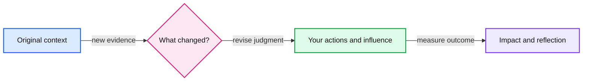

# Stripe Adaptability interview preparation

Show how you changed your technical decisions and leadership approach when the environment or evidence changed.



## Scheduled session

**Monday, November 16, 2026, 6:45–7:30 PM IST.** Interviewer: **Caitriona Kelly**. [Calendar and full schedule](README.md#confirmed-schedule).

## Expectations from the guide

This is a conversation with an Engineering Leader about adaptability, especially when things do not go as planned. Be ready to discuss complex systems, technical tradeoffs, different environments and scales, realized impact, and organizational scaling challenges.

Stripe explicitly evaluates **ability to adapt, communication, and work experience**. Explain how your leadership changed to fit the situation, and what you learned from your technical decisions. Source: [Adaptability](sources/staff-engineer-supplemental.md#adaptability).

## Suggested preparation

Start with three distinct real examples, then add examples where the question bank reveals gaps. An example can cover several themes, but avoid repeating the same story for every question in a mock.

| Example theme | Evidence to recall |
|---|---|
| A technical plan stopped fitting reality | Original assumptions, evidence that invalidated them, options, cost of changing direction, and measured result. |
| Your influence had to change | Team boundaries, competing incentives, how you listened or changed your approach, and how agreement became action. |
| Scale or organizational growth exposed a weakness | Previous operating conditions, the new constraint, technical and ownership changes, rollout, and lasting effect. |

For each example, jot down Situation/Task, Action, Result, and a short reflection. Aim for a 2–3 minute opening answer, then leave room for probing. State what **you** decided and did; credit the team's work separately. Use concrete, nonconfidential numbers when available. Do not invent metrics.

## How to practice

The 40 questions below are practice prompts based on the guide's themes, not known Stripe interview questions. Answer from actual experience. Start with **Q01, Q06, Q11, Q16, Q21, Q26, Q31, and Q36** to sample all eight themes, then work through the rest.

Give a 2–3 minute opening answer, then use the follow-up probes to test its depth. Keep the same question ID when returning to an answer so you can track improvement. You do not need 40 different stories; build enough variety to cover different environments, kinds of failure, and forms of influence.

## Technical decisions and changing your mind

1. **Q01.** Tell me about a time new evidence made you reverse a technical decision you had strongly supported.
2. **Q02.** Describe a design that was appropriate initially but became unsuitable. How did you decide when to replace it?
3. **Q03.** Tell me about a time you simplified an architecture after discovering the complexity was not justified.
4. **Q04.** Describe a time you kept an existing approach despite pressure to adopt a new technology. How did you assess whether changing was necessary?
5. **Q05.** Tell me about a migration where you changed the implementation strategy midway through delivery.

Follow-up probes:

- What did you believe originally, and what specific evidence changed your assessment?
- Which alternative did you reject, and what did the revised decision cost?
- How did you explain the change to people who had backed your original proposal?

## Setbacks and recovery

6. **Q06.** Tell me about a project that did not achieve its original goal. What did you change after recognizing the gap?
7. **Q07.** Describe an incident that exposed a mistaken assumption in your design. How did it change your subsequent engineering decisions?
8. **Q08.** Tell me about a time your first attempt to solve a recurring problem failed. What did you do differently on the next attempt?
9. **Q09.** Describe a time a critical dependency or partner team failed to deliver. How did you adapt the project?
10. **Q10.** Tell me about a project you stopped or substantially reduced in scope. How did you decide that continuing was the wrong investment?

Follow-up probes:

- What was the earliest warning, and why did you act when you did?
- Which part of the outcome was your responsibility?
- What changed permanently after the recovery, and how do you know it helped?

## Ambiguity and shifting priorities

11. **Q11.** Tell me about a project you led when the problem or requirements were unclear. How did you turn uncertainty into a useful next step?
12. **Q12.** Describe a time priorities changed after your team had already invested significant effort. How did you respond?
13. **Q13.** Tell me about an important decision you made with incomplete or conflicting data. How did you limit the risk?
14. **Q14.** Describe a time a deadline became much shorter. How did you decide what to preserve, defer, or change?
15. **Q15.** Tell me about a time you learned you were solving the wrong problem. How did you redirect the work?

Follow-up probes:

- What did you need to learn before committing, and what could safely wait?
- Which decision was reversible, and which needed more evidence?
- How did you keep stakeholders aligned as the goal or plan changed?

## System scale and organizational growth

16. **Q16.** Tell me about a system whose scale outgrew the original design. How did you identify the first constraint and adapt?
17. **Q17.** Describe a time your experience from a larger or smaller system did not transfer well to a new environment.
18. **Q18.** Tell me about an engineering practice that stopped working as the organization grew. What replaced it?
19. **Q19.** Describe a time the main obstacle moved from technology to ownership or coordination. How did your approach change?
20. **Q20.** Tell me about a time you adapted your architecture or delivery plan because the team lacked the capacity to operate the original solution.

Follow-up probes:

- What changed in workload, team structure, or operational needs? Use shareable numbers where available.
- Why was the old approach reasonable before that change?
- What did you change in both the system and the ownership model?

## Influence and disagreement

21. **Q21.** Tell me about a time your usual way of influencing people did not work. What did you change?
22. **Q22.** Describe a technical disagreement where another person's argument changed your position.
23. **Q23.** Tell me about a time you needed cooperation from teams with different priorities and no reporting relationship to you.
24. **Q24.** Describe a time you disagreed with a decision but still had to help the team execute it effectively.
25. **Q25.** Tell me about a time you adapted how you explained a technical issue for engineers, product partners, or leadership.

Follow-up probes:

- What were the other people's goals or concerns, and how did you discover them?
- What changed in your behavior beyond repeating the same argument?
- How did agreement translate into actual ownership and delivery?

## Leadership across different environments

26. **Q26.** Tell me about a time a leadership approach that had worked previously failed in a new team or situation.
27. **Q27.** Describe a time you moved from doing the critical work yourself to enabling others to own it.
28. **Q28.** Tell me about a time you had to become more hands-on than planned. How did you avoid creating a lasting dependency on yourself?
29. **Q29.** Describe a time you adapted your mentoring or feedback style for someone whose needs differed from what you expected.
30. **Q30.** Tell me about a change in team structure, leadership, or ownership that required you to redefine your role.

Follow-up probes:

- What told you your original approach was not serving the team?
- What did you personally stop doing, start doing, or delegate?
- What became possible for others, and did that improvement continue without you?

## Learning and responding to feedback

31. **Q31.** Tell me about difficult feedback that changed how you make decisions or work with others.
32. **Q32.** Describe a time you had to lead work in an unfamiliar technical domain. How did you learn enough to make sound decisions?
33. **Q33.** Tell me about a time a less experienced engineer identified something you had missed. How did you respond?
34. **Q34.** Describe a lesson from an earlier project that you later discovered did not apply. How did you update your judgment?
35. **Q35.** Tell me about a time your reflection led to a concrete change in engineering practice. What happened when you applied it again?

Follow-up probes:

- What did you find difficult to accept or understand initially?
- How did you distinguish a useful lesson from an overreaction to one event?
- What later behavior or outcome shows that you actually changed?

## User needs and competing constraints

36. **Q36.** Tell me about user feedback that changed your technical priorities or design.
37. **Q37.** Describe a time you changed a release plan because of reliability or data correctness concerns.
38. **Q38.** Tell me about a time you reduced cost or complexity while preserving the outcome users needed.
39. **Q39.** Describe a time different user groups needed incompatible things. How did you adapt the solution or rollout?
40. **Q40.** Tell me about a time you balanced an urgent user problem with work that would prevent similar problems later.

Follow-up probes:

- How did you learn what users actually needed, and which assumption did that challenge?
- Who bore the cost or risk of the compromise?
- What evidence showed the result helped users, and what remained unresolved?

## Answer worksheet

Copy this block for any question you want to answer in writing. Short notes are enough before an aloud rehearsal.

```text
Question ID:
Project or experience:

Situation and task: What was the context, goal, and my responsibility?
Change: What assumption, constraint, or evidence changed?
Options: What alternatives did I consider, and what did each cost?
Action: What did I personally change, and how did I work with others?
Result: What actually happened? What evidence supports the outcome?
Reflection: What would I repeat or change, and where did I apply the lesson?

Follow-up I found hardest:
Detail to recover before the next rehearsal:
```

## Suggested 45 minute mock

This is a practice format, not Stripe's published agenda. Use about five minutes for context, then three ten-minute question discussions, five minutes for your questions, and five minutes for feedback. Choose questions from different themes and use a different example for each main answer where possible.

- **Mock A:** Q01, Q21, Q16. Technical judgment, influence, and scale.
- **Mock B:** Q06, Q26, Q36. Recovery, leadership, and user needs.
- **Mock C:** Q11, Q31, Q20. Ambiguity, feedback, and operational constraints.

## Self review

- Can someone understand the change in constraints without knowing your company?
- Did you explain the alternatives, your decision, and how you brought others along?
- Is the result realized and specific, including what remained imperfect?
- Does your reflection describe a change in your behavior or judgment?

## Tradeoffs to make explicit

Explain why the revised approach fit the new constraints and what it cost in delivery time, reliability, engineering effort, or team coordination. Preserve uncertainty where you lacked information at the time. A useful story includes both the decision and the evidence that would have made you choose differently.
