# Stripe Integration interview preparation

Read an unfamiliar specification, integrate existing libraries and code, and prove the resulting behavior works.

```mermaid
%% Integration workflow for a timed rehearsal
flowchart LR
    S["Spec and API docs"] -->|extract contract| P["Small implementation plan"]
    P -->|connect existing code| C["Working integration"]
    C -->|verify behavior| T["Tests and observed output"]
    T -->|failed expectation| C
    class S client
    class P,C service
    class T store
    classDef client fill:#dbeafe,stroke:#2563eb,stroke-width:2px,color:#111
    classDef service fill:#dcfce7,stroke:#16a34a,stroke-width:2px,color:#111
    classDef store fill:#ede9fe,stroke:#7c3aed,stroke-width:2px,color:#111
```

## Scheduled session

**Wednesday, November 18, 2026, 3:30–4:30 PM IST.** Interviewer: **Nitin Verma**. [Calendar and full schedule](README.md#confirmed-schedule).

## Expectations from the guide

You receive a specification and documentation at the start. Read them before implementing. The focus is combining existing libraries and code to fulfill the spec, with attention to code quality and abstractions. Testing matters because your changes must preserve the surrounding system's behavior.

Stripe explicitly evaluates **ability to help yourself, abstractions and writing code, correctness/testing/debugging, and interaction and collaboration**. The general technical guidance also asks for familiarity with an HTTP client and requests to a public API. Source: [Integration](sources/staff-engineer-supplemental.md#integration) and [Technical Interviews](sources/staff-engineer-supplemental.md#technical-interviews).

Use your strongest language. The guide allows documentation, Google, and Stack Overflow. Its ordinary technical interview rules prohibit AI assistants and AI-generated search answers. The separate HackerRank AI exercise is a different round.

## Suggested preparation

- Verify that you can run an existing project, run its tests, inspect a failure, and set a breakpoint or use simple logging on your personal computer.
- Rehearse your HTTP client's request parameters, headers, JSON parsing, status handling, timeouts, and binary response handling where relevant.
- Read a new API contract before coding: method, endpoint, authentication, request schema, response schema, errors, and any limits.
- Build the smallest working path early. Keep transformations and transport boundaries easy to test without adding unnecessary layers.
- When blocked, inspect the docs, response, stack trace, or smallest reproduction. Explain what you learned and ask a focused question when needed.

## Suggested 60 minute mock

This is a rehearsal budget. Stripe's guide says the first five minutes are for settling in and checking setup; it does not specify the remaining split for Integration.

| Minutes | Goal |
|---|---|
| 0–5 | Verify setup and understand the context. |
| 5–12 | Read the spec and docs, clarify outputs and constraints, inspect the starter. |
| 12–35 | Implement and run one complete path, then extend to the remaining requirements. |
| 35–50 | Test contract details, error paths, and existing behavior. Debug from evidence. |
| 50–55 | Finish the highest value gap and rerun relevant checks. |
| 55–60 | Explain correctness, limitations, and next steps. |

## Practice already in this repository

Start with the [Java BikeMap practice workspace](../../lld-practise/bikemap-integration/practice-version/README.md) or the [original Python BikeMap kit](../../ai-coding/03-bikemap-integration/README.md). Both provide an unfamiliar API, a small existing application, and a local fake service. Use them as skill drills, not predictions of your actual prompt. Follow the starter instructions and keep interviewer materials closed during the first run.

The kit's older AI-policy uncertainty is superseded for your preparation by the supplied guide: run this mock **without AI**. If you choose Java, rehearse the same contract-reading and HTTP skills in Java rather than switching languages just for this exercise.

For a second mock, use a fresh documented API or repeat with an unseen requirement. Check only cases the contract makes relevant:

| Behavior | Evidence of correctness |
|---|---|
| Successful request | Actual request shape and expected response or saved output. |
| Empty or boundary input | Defined result without unexpected calls or crashes. |
| Non-success response or timeout | Deliberate handling that preserves the error context. |
| Unexpected data | Clear failure or validation consistent with the contract. |
| Existing behavior | Relevant baseline tests still pass. |

## Tradeoffs to make explicit

Prefer a small correct integration over speculative infrastructure. Explain where you placed an abstraction and why. Add retries only when the contract and operation semantics justify them; a timeout on a write does not prove the server did nothing. Distinguish what your tests prove from what still needs verification against the real API.
