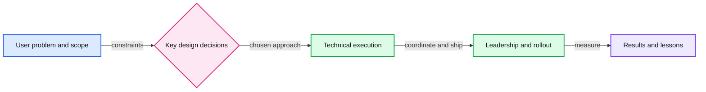

# Stripe Technical Discussion interview preparation

Prepare a 20-minute walkthrough of a completed project that demonstrates technical depth and your leadership across engineering and organizational challenges.

## Scheduled session

**Thursday, November 19, 2026, 12:00–12:45 PM IST.** Interviewers: **Raghu Vanga and Ravi Sharma**. [Calendar and full schedule](README.md#confirmed-schedule).

## Expectations from the guide

Facilitate a small group discussion about a technical project you led that **has come to fruition**. Prepare **20 minutes of material** and expect approximately **20 minutes of questions**. Supporting material is welcome but optional; screen sharing is available through Zoom.

Choose meaningful scope, complexity, or scale. Cover technical, organizational, and people challenges. Explain your personal work as well as what you enabled in the team. The audience consists of experienced engineers and managers who may be unfamiliar with your domain, so explain concepts and acronyms. Discuss technology choices, alternatives, tradeoffs, and the difficult parts of delivery. Source: [Technical Discussion](sources/staff-engineer-supplemental.md#technical-discussion).

This is a project discussion, rather than the guide's separate Design Challenge. The guide does not publish a separate evaluation bullet list for this session; the preparation below follows the qualities it asks you to demonstrate.

## Choose the project first

Pick a completed project you personally led and can explain deeply using shareable details. Favor one with consequential design choices, cross-team dependencies, a difficult rollout or setback, and observable outcomes. Do not choose solely by system size or novelty.

Write your own one-sentence description of the user problem, your responsibility, what shipped, and the result. Then check that you can support every part with a concrete example.

## Suggested 20 minute structure

| Time | Content | Evidence to prepare |
|---|---|---|
| 0–3 min | User problem, context, scope, and your role | Why the project mattered, constraints, team size, duration, and your ownership. |
| 3–8 min | Architecture and one important flow | A readable diagram, interfaces, data model, and the relevant scale or reliability needs. |
| 8–13 min | Two consequential decisions | Alternatives, constraints, why you chose the approach, and what it cost. |
| 13–17 min | Delivery and leadership | Cross-team work, disagreement, a setback, migration or rollout, and how you enabled others. |
| 17–20 min | Results and reflection | Shareable before/after evidence, remaining limitations, and what you would change. |

Use one main architecture diagram and a few supporting notes if useful. Keep optional deeper material separate so questions can guide the detail. Draft any presentation content yourself in accordance with the guide's rules for interview work.

## Rehearsal questions

These are practice prompts, not known Stripe questions.

- What was the hardest decision you personally made, and which option did you reject?
- Where did the system fail or reach a limit? How did you identify the cause?
- How did you migrate safely, detect trouble, and roll back if needed?
- Which team dependencies or incentives made delivery difficult?
- What did another engineer become able to do because of your contribution?
- How do you know the project improved the user's experience?
- What remains weak, and what would cause you to revisit the design?

## Readiness check

- You finish the main narrative in 20 minutes, including background.
- You explain the important request or data flow without relying on company jargon.
- You distinguish your decisions, team execution, and stakeholder contributions.
- Your outcomes are supported by actual evidence; sanitized figures are labeled appropriately.
- You can discuss both technical depth and organizational difficulty under questions.
- You have tested opening the material and sharing it over Zoom.

## Tradeoffs to make explicit

For each major choice, explain the requirement it served and the cost in complexity, reliability, latency, money, or engineering time. Show why the decision made sense with the information available then, and what new evidence would justify changing it. Prefer two decisions explained well over a catalog of every component.
