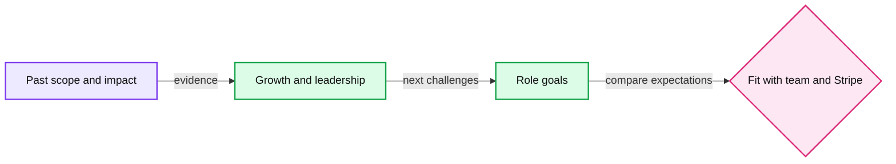

# Stripe Hiring Manager Chat preparation

Connect your strongest experience and next-role goals to the Staff Engineer role, and use the conversation to understand the team's expectations.

## Scheduled session and guide mapping

**Wednesday, November 25, 2026, 12:00–1:00 PM IST.** Interviewer: **Vaibhav Agarwal**. [Calendar and full schedule](README.md#confirmed-schedule).

The invitation says **Hiring Manager Chat**. The closest guide section is **Experience & Goals**, a conversational interview with an Engineering Leader. This mapping is inferred; the guide does not explicitly equate the titles. Confirm the format with the recruiter if you need certainty, and use the topics below as preparation meanwhile.

## Expectations for Experience and Goals

The guide covers significant project scope and complexity, technical growth, collaboration, a healthy and inclusive working environment, mentoring and upskilling, career goals, and why Stripe interests you. It explicitly evaluates **career fit, communication, and work experience**. Source: [Experience & Goals](sources/staff-engineer-supplemental.md#experience--goals).

Prepare concrete project and people details, including team size, number of engineers you led, duration, your contribution, and realized results. Review the actual job description and relate your experience to its responsibilities.

## Suggested preparation

| Topic | What to prepare in your own words |
|---|---|
| Career narrative | A concise explanation of your scope, how it grew, and what you want to do next. |
| Significant technical work | One challenging completed project with your decisions, influence, and outcome. |
| Enabling others | A specific contribution that made colleagues more effective, including mentoring or shared technical direction. |
| Collaboration and inclusion | A real disagreement or cross-functional problem, how you included perspectives, and what changed. |
| Why Stripe and this role | Specific interests grounded in the role description, Stripe products, and the work you want to own. |
| What you need next | Desired scope, manager partnership, environment, learning opportunities, and constraints that matter to you. |

Reuse project context when useful, while keeping several distinct examples available. Do not turn the chat into a second full project presentation unless asked.

## Questions to ask the hiring manager

Choose the questions whose answers would most affect your decision.

- What outcomes would you expect from this Staff Engineer in the first six and twelve months?
- Which Core Infrastructure problems currently constrain product teams or users most?
- How are architecture decisions and ownership divided across teams?
- How do Staff Engineers balance hands-on delivery, technical direction, and developing other engineers?
- How does the team prioritize reliability, migration work, and delivery speed?
- What distinguishes someone who thrives in this team from someone who struggles?

## Tradeoffs to clarify

Be specific about the balance you want among coding, cross-team influence, operational ownership, and longer-term technical direction. Explain your preferences using experience and ask how the role works in practice. Treat fit as a concrete discussion of responsibilities and working conditions.
