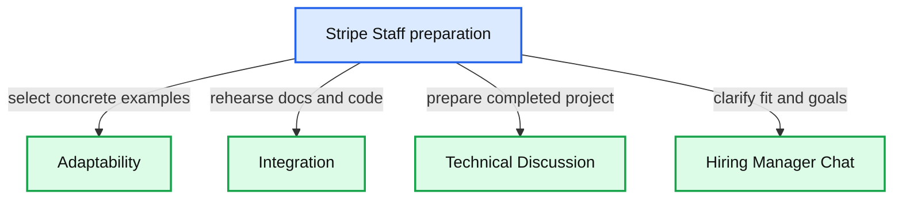

# Stripe Staff Engineer interview preparation

Prepare for four scheduled interviews for **Staff Engineer, Core Infrastructure**, with a completed project deep dive, specific leadership examples, and practical API integration practice.

## Confirmed schedule

All times are **India Standard Time, Asia/Kolkata, UTC+05:30**. Calendar checked November 7, 2026. All four invitations are confirmed and accepted.

| Date | Time in IST | Duration | Interview and preparation | Interviewers | Calendar |
|---|---|---|---|---|---|
| Mon Nov 16, 2026 | 6:45–7:30 PM | 45 min | [Adaptability](01-adaptability.md) | Caitriona Kelly | [Open event](https://www.google.com/calendar/event?eid=Z3RlNDU3MWY0ZjViMGI5ZDMyMzE4MjZjNTVkY2RlODdmYzQxOTYzMjdhZWRhNWI3YTA1Mzk2YTIyY2RlMWEyMTMwIHZpY2t5MjIyOTFAbQ&ctz=Asia/Kolkata) |
| Wed Nov 18, 2026 | 3:30–4:30 PM | 60 min | [Integration](02-integration.md) | Nitin Verma | [Open event](https://www.google.com/calendar/event?eid=Z3RkMzliMTI0MzhjMDNlOWZkZDJhMWVhNzNiYTkzNzdkYWQyNTljNTA5MmZiYWZiNTQ5Zjc2MWVmMjJlMWRjNzliIHZpY2t5MjIyOTFAbQ&ctz=Asia/Kolkata) |
| Thu Nov 19, 2026 | 12:00–12:45 PM | 45 min | [Technical Discussion](03-technical-discussion.md) | Raghu Vanga and Ravi Sharma | [Open event](https://www.google.com/calendar/event?eid=Z3Q5ZTQ3YzliNjUzNTBkNDFiZTk4OTk2MDcxNTQzNTg5OWQ1MTQ0YTFiOGUzMWI5N2Y4MDAxMGM3NTJjNDdlMmJmIHZpY2t5MjIyOTFAbQ&ctz=Asia/Kolkata) |
| Wed Nov 25, 2026 | 12:00–1:00 PM | 60 min | [Hiring Manager Chat](04-hiring-manager-chat.md) | Vaibhav Agarwal | [Open event](https://www.google.com/calendar/event?eid=Z3RhODA5M2MyZDdkNmNjZmFjNzlhOWJkMDczYzZmYzkwZWRhYTI0N2Q5YmM2Mzg3MmY0YTBmNDJjNjQyYzQwNDk2IHZpY2t5MjIyOTFAbQ&ctz=Asia/Kolkata) |

Use the Zoom link in the live calendar event on interview day. Stripe says links in the original email may change.

## What each interview requires

| Interview | Guide expectation | Preparation output |
|---|---|---|
| Adaptability | Discuss how your technical judgment and influence changed across environments, especially when plans failed. Evaluates adaptability, communication, and work experience. | Three distinct examples with a changed assumption, your response, realized impact, and reflection. |
| Integration | Read a spec and documentation, then combine libraries and existing code into a working solution. Evaluates self-sufficiency, abstractions, coding, testing, debugging, and collaboration. | A working local environment and two timed integration rehearsals without AI. |
| Technical Discussion | Lead a small group through a completed project with technical, organizational, and people complexity. Prepare 20 minutes of material and expect about 20 minutes of questions. | A rehearsed 20-minute project walkthrough with architecture, alternatives, personal ownership, outcomes, and lessons. |
| Hiring Manager Chat | Likely maps to the guide's Experience & Goals interview: career fit, communication, significant work, collaboration, inclusion, mentoring, and next-role goals. | Career narrative, concrete examples, reasons for Stripe, and questions about Staff scope. Confirm the title mapping with the recruiter if needed. |

The guide also describes Design Challenge, AI-Enabled Programming Exercise, and a full-stack UI round. Those are not among these four upcoming invitations; their inclusion in the general guide does not establish that they are scheduled for you.

## Start here

1. Follow the [preparation plan](prep-plan.md), starting the Technical Discussion project early.
2. Read the relevant round note before each rehearsal.
3. Fill in examples from your own work. Use only shareable details and distinguish your contribution from the team's.
4. Read the [original supplemental guide](sources/staff-engineer-supplemental.md) for the complete expectations and setup links.

## Interview tool rules

The guide prohibits AI assistance for ordinary interview problems, including AI search answers, and says interview work and written projects should use your own skills unless Stripe agrees otherwise in writing. For **Integration**, practice and interview without AI; docs, Google, and Stack Overflow are allowed under the guide's rules.

The separately named **AI-Enabled Programming Exercise** permits only the assistant built into HackerRank. That exception does not apply to the Integration invitation. These notes provide preparation structure, not answers to submit or present as interview work.

Use a personal computer with a working editor, runtime, debugger, and HTTP client. The guide recommends its [environment setup walkthrough](https://docs.google.com/document/d/1GkfCBnjnq-YM1kbZouCVck5szwfsiXreHFDFOwnM9PA/edit?tab=t.0). Test Zoom and screen sharing before the day.

## Sources and preparation choices

The schedule and interviewer names come from your Google Calendar invitations. Round expectations come from [WTE Supplemental Staff Engineer](sources/staff-engineer-supplemental.md), copied unchanged from Downloads. Rehearsal questions, time splits, and practice priorities in the round notes are suggested preparation, not promised interview questions.

Prioritize the scheduled interviews. Reuse existing practice kits for skills, while treating your supplied guide as the authority for this loop's format and AI rules.

