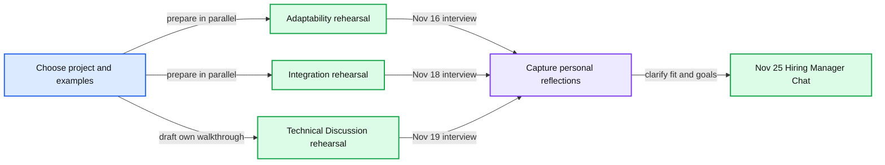

# Stripe interview preparation plan

Start the completed-project discussion now, then rehearse adaptability and API integration before the first interview on November 16.

## Suggested schedule

Use 60–90 minutes on a preparation day where possible. Adjust the time to your availability; these are suggested work blocks, not calendar events.

| Date in November 2026 | Focus | Finish with |
|---|---|---|
| 7–8 | Read the guide, choose a completed project, and inventory three distinct leadership examples. | Project choice, rough 20-minute outline, and short evidence notes for each example. |
| 9 | Verify the local environment and rehearse HTTP and documentation basics without AI. | A program that makes a request, inspects the result, and handles a failure. |
| 10–11 | Develop your own Technical Discussion material and rehearse Adaptability examples. | One clear architecture sketch, two decisions with alternatives, and concise story openings. |
| 12 | Complete a timed Integration mock without AI. | Observed output, relevant passing checks, and a short list of weak skills. |
| 13 | Rehearse the project discussion aloud for 20 minutes, then probe it with questions. | A narrative that fits the time and makes your ownership clear. |
| 14–15 | Mock Adaptability, patch the biggest integration gap, and do a light final review. | Three examples you can discuss flexibly and a working environment. |
| 16 | Adaptability at 6:45 PM IST. | A brief personal reflection after the session. |
| 17 | Second Integration mock without AI, followed by a short project walkthrough. | Confidence with docs, execution, and verification; project material ready before the adjacent interviews. |
| 18 | Integration at 3:30 PM IST. Keep later project review light. | Openable project material and tested screen sharing for the next day. |
| 19 | Technical Discussion at noon IST. | A brief personal reflection and questions to carry into the manager conversation. |
| 20–24 | Review the actual role description, career goals, collaboration examples, and questions for the manager. | Your own concise career narrative and a prioritized question list. |
| 25 | Hiring Manager Chat at noon IST. | A clear discussion of mutual expectations and next steps. |

## Evidence to gather

Keep short private notes from your own experience. Use shareable information and avoid confidential material.

| Example | Details to recall |
|---|---|
| Completed project | User problem, timeline, team size, your ownership, architecture, alternatives, rollout, outcome, and lessons. |
| Changed direction | Original assumption, new evidence, revised approach, who needed to agree, cost of the change, and result. |
| Cross-team challenge | Different goals, your influence, decisions and ownership, how delivery moved forward, and result. |
| Mentoring or enabling others | Starting problem, what you did, how the other person or team became more effective, and durable effect. |

Use the guide's Situation/Task, Action, Result structure for behavioral answers. Choose relevant operating principles through your actions: Users first; Create with craft and beauty; Move with urgency and focus; Collaborate egolessly; Obsess over talent; Stay curious. Avoid forcing every principle into one example.

## Before each interview

- Open the live calendar event and use its current Zoom link.
- Check audio, camera, screen sharing, power, and internet.
- For Integration, verify the runtime, tests, debugger, and HTTP client; disable AI assistance.
- For Technical Discussion, have your own material and a clear main diagram ready.
- Keep the recruiting coordinator's contact available from the confirmation email in case of technical trouble.

## Preparation tradeoffs

The Technical Discussion is the day after Integration, so finish the main project preparation before November 18. Spend extra preparation time on your weakest scheduled round. Broader system design or AI-enabled coding practice is secondary to these four confirmed sessions.
